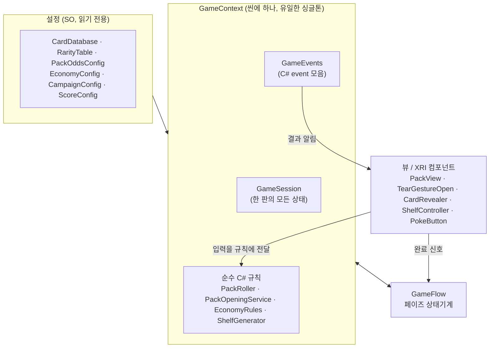
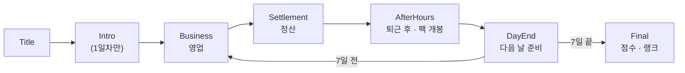
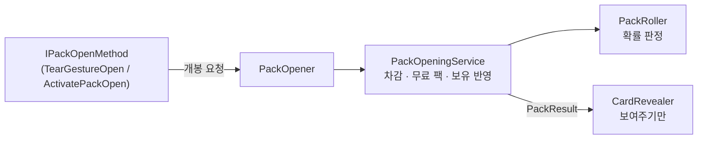

# 시스템 설계 한눈에 보기 (2026-11-16)

> 오늘 정한 설계를 한 장으로 모은 요약입니다. 자세한 내용은 원문을 봅니다.
> - 전체 구조: [`카드깡_시스템설계서_v1.md`](카드깡_시스템설계서_v1.md)
> - 팩 개봉 연출: [`카드팩_개봉연출_설계.md`](카드팩_개봉연출_설계.md)
> - 카드 아트 규칙: [`카드아트_Gemini_프롬프트_가이드.md`](카드아트_Gemini_프롬프트_가이드.md)
> - 결정 기록: `DevLog/decisions/` DEC-001, DEC-002

**목표**: 5일 안에 완성하면서도 수치 · 카드 · 일수를 **코드 수정 없이** 바꿀 수 있는 구조

---

## 1. 설계 원칙 6가지

| 원칙 | 한 줄 설명 |
|---|---|
| 수치는 코드 밖에 | 확률 · 가격 · 일수 · 랭크 기준은 ScriptableObject(SO) 설정 파일에 |
| 규칙과 VR 화면을 나눔 | 확률 · 정산 · 점수는 순수 C# 클래스 → 헤드셋 없이 테스트 가능 |
| 바뀔 곳만 인터페이스로 | 팩 개봉 방식(`IPackOpenMethod`), 난수(`IRandomSource`) 두 곳만 |
| 카드 ID는 문자열 | `F-N1`, `SN-L`처럼 아트 가이드의 ID를 그대로 데이터 키로 |
| 데이터는 검증됨 | 카드 50장 구성 · 확률 합 · 아트 누락을 메뉴 한 번으로 검사 |
| 기획서 수치 = 테스트 기대값 | 기획서 확률표를 단위 테스트가 그대로 확인 |

**하지 않는 것**: DI 프레임워크, 범용 이벤트 버스, 세이브 시스템(한 판 25~30분), 네트워크

---

## 2. 전체 구조



- **GameSession**: 일차 · 재화 · 보유 카드(ID + 장수) · 진열 · 당일 장부 · 통계. 새 게임 = `new GameSession()`
- **GameEvents**는 static이 아니라 GameContext가 가짐 → 도메인 리로드를 꺼도 구독이 남지 않음
- 카드는 데이터로 "ID + 장수"만 보관. 바인더 · 상자는 이 데이터를 그리는 화면일 뿐

### 폴더 · 어셈블리
```text
Assets/
  00. Scenes/     Shop.unity (씬은 이것 하나. 타이틀도 같은 씬의 TitlePhase)
  01. Scripts/    Runtime/(Core·Data·Logic·Interaction·Presentation·UI·DebugTools) · Editor/ · Tests/
  02. Data/       cards.csv(원본) → 카드 SO 50개, 설정 SO
  03. Prefabs/    Card, Pack
  04. Art/  05. Shaders/  06. Audio/  98. Doc/  99. External Assets/
```
어셈블리는 Runtime · Editor · Tests 3개만. 네임스페이스 루트는 `CardShop`.

---

## 3. 데이터

| 무엇 | 어떻게 |
|---|---|
| 카드 50장 | `02. Data/cards.csv`가 원본 → `Tools > CardShop > Import Cards CSV`로 SO 생성, 아트는 파일 이름 규칙으로 자동 연결 |
| 등급별 값 | 기준가 · 손님 구매 확률은 `RarityTable`이 원본 (카드마다 중복 입력하지 않음) |
| 팩 확률 | `PackOddsConfig`: 슬롯 확률표 + 단서 배율(×1.5, ×2)만 저장, 단서 확률은 **규칙으로 계산** |
| 경제 · 일정 · 점수 | `EconomyConfig` · `CampaignConfig`(일차별 영업 시간 · 손님 수) · `ScoreConfig` |
| enum | 값을 숫자로 명시(`Normal = 0` …) → 순서를 바꿔도 직렬화가 깨지지 않음 |

---

## 4. 게임 흐름 (페이즈 7개)



- 페이즈마다 파일 하나(`Enter / Tick / Exit`) → 흐름 수정이 한곳에서 끝남
- **일시정지는 `Time.timeScale = 0`을 쓰지 않음**. 물리 기반 잡기가 멈추기 때문. 대신 `GameFlow.IsPaused` 플래그로 타이머 · 손님만 멈춤
- 뼈대 우선: 1일차에 빈 페이즈로 "시작 → 7일 → 최종"을 먼저 돌려, 일정이 밀려도 끝까지 플레이되는 빌드를 유지

---

## 5. 팩 개봉 — 오늘 가장 많이 다룬 부분

### 5-1. 판정과 연출을 나눔

- **판정은 개봉하는 순간 한 번만**. 선반에 놓인 순간 결과가 정해지지 않으므로 디버그 강제와 충돌 없음
- 카드는 개봉 즉시 보유 목록 · 도감에 들어감. 화면의 물리 카드는 보여주기용이라 떨어뜨려도 카드를 잃지 않음
- 연출을 건너뛰거나 중간에 페이즈가 바뀌어도 데이터는 같음

### 5-2. PackRoller 판정 순서
1. 갓팩(0.2%) → 5장 모두 유니크 85% / 레전더리 15%
2. 레전더리 확정 팩(1.0%) → 5번 슬롯 레전더리
3. 아니면 슬롯별 판정 (단서 보정은 단일 팩 4 · 5번 슬롯만)
4. 등급 안에서 카드는 균등 추첨

### 5-3. 선반: 확률과 방향을 분리 (DEC-001)
| 상태 | 정해지는 때 | 확률 영향 |
|---|---|---|
| `Clue` (접힘 · 뒤집힘 단서) | 선반 생성 시 (75/20/5) | **있음** |
| `IsFaceDown` (지금 앞/뒤) | 플레이어가 바꿈 | 없음 |

→ 플레이어가 마음에 드는 팩을 뒤집어 "찜"해도 확률은 조작되지 않음. 슬롯은 앞면/뒷면 두 자세로 스냅, 선반 밖에 놓친 팩은 3초 뒤 복귀

### 5-4. 개봉 조작 — Pocket 4단계를 VR로
| Pocket | 우리 게임 (VR) | 상태 |
|---|---|---|
| ① 고르기 | 선반에서 팩 집기 + 단서 + 직접 뒤집어 표시 | ✅ |
| ② 자르기 | **왼손 그립** → 팩이 눈앞 35cm에 월드 고정 → **오른손 트리거**로 윗부분 선을 따라 그음(손끝 또는 레이저), 70%면 개봉 | ✅ 1차 (실기기 확인 전) |
| ③ 한 장씩 넘기기 | 팩 자리에 앞면 묶음 5장 → 오른손 트리거마다 맨 앞 카드가 카운터로 날아감 | ✅ 1차 |
| ④ 모아 보기 | 카운터 위 5장 + NEW 배지 | 펼침만 (배지 없음) |
| 상자 10팩 | 결과판에 1/10 ~ 10/10 한 줄씩 → 좋은 카드 5장 | ✅ 1차 |

- 오른손은 팩을 **잡지 않고** 트리거 입력과 위치만 읽음 → 두 손이 팩을 뺏어 잡는 문제가 없음
- 자르기가 어려우면 프리팹의 컴포넌트만 `ActivatePackOpen`(든 손 트리거)으로 바꾸면 됨

### 5-5. 등급별 연출 예산
좋은 카드일수록 공개가 느려짐 = 연출 길이가 등급 신호

| 등급 | 멈춤 | 진동 세기 | 빛 · 소리 |
|---|---|---|---|
| 노말 | 0.15초 | 0.1 | 종이 넘김 |
| 레어 | 0.25초 | 0.2 | 테두리 반짝 |
| 수퍼레어 | 0.4초 | 0.4 | 홀로그램 |
| 유니크 | 0.6초 | 0.6 | 글로우 + 뒷면 빛샘 |
| 레전더리 | 1.0초 | 1.0 | 강한 글로우 + 파티클 |

- 멈춤 · 진동은 구현됨(`CardRevealer` 인스펙터 값). 빛 · 소리는 `RarityRevealProfile` SO로 다음에 추가
- 한 팩 연출은 보통 4초, 레전더리가 있어도 7초 안 (7일간 약 72팩을 열기 때문)
- Quest 성능: 파티클은 레전더리만, 한 번만 재생

---

## 6. VR 상호작용 정리

| 대상 | XRI | 비고 |
|---|---|---|
| 팩 · 카드 · 쓰레기 · 걸레 | Grab | |
| 바인더 · 진열대 · 쓰레기통 | Socket | Interaction Layer로 받을 대상 제한 |
| 결제 · 상자 · 퇴근 버튼 | Poke | |
| 타이틀 · 정산 · 최종 UI | Ray | |

- **바인더는 소켓 1개**: 표지에 꽂으면 해당 칸에 자동 배치 (50칸에 소켓을 두지 않음)
- **눈높이 보정**: XR Origin은 바닥 기준 트래킹, 시작 · 새 게임 때 눈높이를 1.6m에 맞춤 (키 · 자세가 달라도 카운터에 손이 닿게). 카메라를 계속 움직이지 않고 한 번만 옮겨 멀미 영향이 적음
- 머리에 붙는 연출(Head-locked)은 쓰지 않음 → 카드 묶음 · 눈앞 팩은 모두 월드 고정

---

## 7. 기획서 공백 검토 결과 (14개 중 확정한 것)

| # | 내용 | 확정 |
|---|---|---|
| Q1 | 영업 종료 | 마지막 손님 퇴장 + **30초** 정리 시간 후 정산 |
| Q3 | 팩 구매 | 개봉을 시작하는 순간 차감, 하루 첫 팩 무료 |
| Q4 | 하루 끝내기 | 카운터의 "퇴근" Poke 버튼 |
| Q6 | 뒤집힘 단서 vs 플레이어 뒤집기 | 확률은 단서 플래그, 방향은 플레이어가 놓은 대로 (DEC-001) |
| Q8 · Q9 | 진열 · 도감 | 퇴근 전 언제든 진열, 도감은 최초 획득 기준(팔아도 유지) |
| — | 씬 구성 | Title/Shop 2개 → **Shop 1개** |

나머지(Q2, Q5, Q7, Q10~Q14)는 제안값으로 진행하고 구현하면서 조정합니다.

---

## 8. 카드 아트 규칙 (DEC-002)

| 규칙 | 내용 |
|---|---|
| 몸 모양 | 둥근 돔형 젤리 하나. 귀 · 머리카락 · 팔다리 · 꼬리 금지. 납작 · 통통 · 살짝 퍼진 바닥 정도는 허용 |
| 얼굴 기본틀 | 짙은 적갈색 둥근 눈 + 하이라이트 2개 + 분홍 볼. 표정에 따라 눈 모양 · 입만 바뀜 (레전더리는 신화적인 눈) |
| 등급 표현 | 색 · 안쪽 빛 · 표정 · 착용 아이템 · 몸 주위 효과로만 |
| 수퍼레어 | 장비 없이 몸에서 터지는 힘 (빛나는 코어, 이중 효과, 튀어 오르는 동작) |
| 유니크 | 왕관 대신 **속성별 머리 장식** (유명 게임 디자인과 닮지 않게) |
| 레전더리 | 돔형 몸 + 몸 안 소용돌이 + 몸 **뒤** 거대한 후광 |

---

## 9. 아직 정하지 않은 것

- [잠정] 카드 넘기기: 오른손 트리거 vs 집어 빼기 → 실기기에서 비교
- [잠정] 단일 팩 카드: 앞면 묶음 vs 뒷면에서 한 장씩 뒤집기 → "5번째 빛샘"과 함께 검토
- 왼손잡이 설정
- 랭크 기준 수치 → 밸런스 시뮬레이터 결과로 재설정 (5일차)
