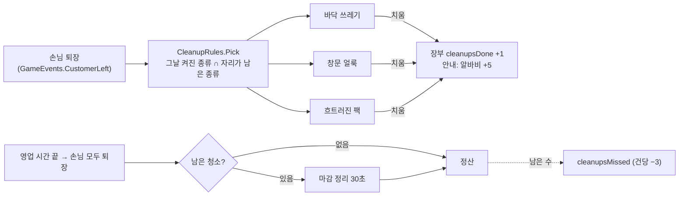

# 청소 시스템 구현 메모 (2026-11-18)

> 기획서 5-1 "청소 구역 3종" · 5-5 "청소 +5 / −3" · 설계서 7-4 · Q1 "마감 정리 30초"를 코드로 옮긴 기록입니다.
> 설계서에 적힌 그대로 한 부분과, **Claude가 정한 부분(사용자 검토 전)** 을 나눠 적습니다.

## 1. 흐름

| 코드 | 하는 일 |
|---|---|
| `CleanupRules` (순수 C#) | 종류 뽑기 · 마감 판단 · 얼룩 진행도. `CleanupRulesTests` 5개 |
| `CleanupDirector` | 손님 퇴장 때 구역 생성, 완료 시 장부 · 안내, `EndDay()`로 남은 구역 걷어 내고 못 치운 수 반환 (`ICleanupFloor`) |
| `CleanupSpot` (추상) | `TrashSpot` · `SmudgeSpot` · `MessyPackSpot`. 공통 이벤트 `Completed` |
| `HeldItem` | 쓰레기 · 걸레 · 꽂이 팩의 공통 잡기. 물리 없음, 놓친 물건은 1.2초 뒤 제자리 (계산대 물건과 같은 방식) |
| `BusinessPhase` | 손님이 다 나가면 남은 청소가 있을 때만 마감 정리 시간을 기다림. 정산으로 갈 때만 감점을 적음 |
| `CleanupBuilder` (에디터) | `Build Shop Scene`이 쓰레기통 판정 · 쓰레기 원본 3종 · 창 자리 4곳 · 걸레 받침 · 팩 꽂이를 만듦 |

청소 종류를 줄이는 축소안(기획서 8장)은 `CampaignConfig.asset`의 일차별 `cleanupKinds`만 바꾸면 됩니다.

## 2. Claude가 정한 것 (검토 필요)

| # | 정한 것 | 이유 | 바꾸려면 |
|---|---|---|---|
| C1 | 쓰레기통 · 팩 꽂이는 **소켓 대신 "근처에서 놓으면 들어감"** 판정 | 종이봉투(계산 확장 4단계)와 같은 방식. 소켓은 Interaction Layer · 호버 메시 설정이 늘고, 바닥 물건을 레이저로 잡았을 때 소켓이 먼저 빼앗는 문제가 있음 | 기획서 "Socket" 표기를 지키려면 `TrashBin` · `PackRack`을 `XRSocketInteractor`로 교체 |
| C2 | 흐트러진 팩은 **판매 진열대 위 팩 꽂이(4칸)** 의 팩이 바닥으로 떨어지는 방식 | 손님이 구경하는 곳이 진열대라 자연스러움. 빈 칸이 보여서 어디에 꽂을지 바로 앎. 플레이어 팩 선반(단서 · 확률)과 섞지 않음 | `ShopLayout.PackRackSlots` · `PackRackSpacing`, 손님당 떨어지는 수는 `CleanupDirector.packsPerMess`(2) |
| C3 | 걸레는 **창 앞 회색 받침** 위 (`ShopLayout.RagStandPos`, 손님 동선 밖) | 창으로 걸어가야 하므로 도구도 창 가까이. 멀리서 레이저로 잡아도 손으로 끌려옴 | 받침 위치 값 |
| C4 | 얼룩은 투명도 대신 **크기가 줄어듦** (다 문지르면 사라짐) | URP 투명 재질을 코드로 만들면 Quest 빌드에서 셰이더 변형이 빠질 위험. 크기 변화로도 진행이 보임 | `SmudgeSpot` 시각 처리 |
| C5 | 얼룩 다 지우기 = 걸레를 얼룩 위에서 **누적 1.2m** 움직임 (15cm씩 약 8번) | 설계서 7-4 "누적 거리" 그대로, 값만 정함 | `SmudgeSpot.requiredMeters` (Smudge 원본) |
| C6 | 디버그 "영업 즉시 종료"는 마감 정리를 건너뛰고 **남은 청소를 감점**으로 셈 | 디버그로 넘겨도 정산 숫자가 실제 규칙대로 나오게 | `BusinessPhase.OnAdvanceRequested` |
| C7 | 손님이 화나서 떠나도 청소 구역은 생김 | 진열대를 구경하고 간 것은 같음. 감점이 겹치지 않음(떠난 손님 감점 0, DEC-012) | `CleanupDirector.OnCustomerLeft` |

## 3. 실기기에서 볼 것
- **창문 얼룩 위치**: `ShopLayout.SmudgePositions` 4곳이 실제 유리 위인지(창틀 · 기둥에 걸리지 않는지), 높이가 손이 닿는지
- 바닥 쓰레기를 **레이저로 잡기** 쉬운지 (잡기 판정 반지름 9cm), 쓰레기통에 넣는 범위(반지름 32cm · 높이 1.3m 아래)
- 팩 꽂이 팩이 진열대 위에서 잘 보이는지, 바닥에 떨어진 팩이 진열대 밑으로 숨지 않는지
- 마감 정리 30초가 적당한지 (`CampaignConfig.closingCleanupSeconds`)
- 하루 수입: 손님 3~6명 전부 청소 시 기본급 40 + 5 × 손님 수 (기획서 5-5)

## 4. 아직 안 한 것
- 청소 안내는 지금 `Notice`(진행 패널 한 줄)뿐. 사장님 말풍선 · 하이라이트는 튜토리얼(설계서 7-5) 때
- 정산 화면 UI: 장부에 `cleanupsDone` · `cleanupsMissed`가 쌓이므로 화면에서 줄만 추가하면 됨
- 청소 속도 보너스(기획서 8장에서 먼저 빼는 항목)
