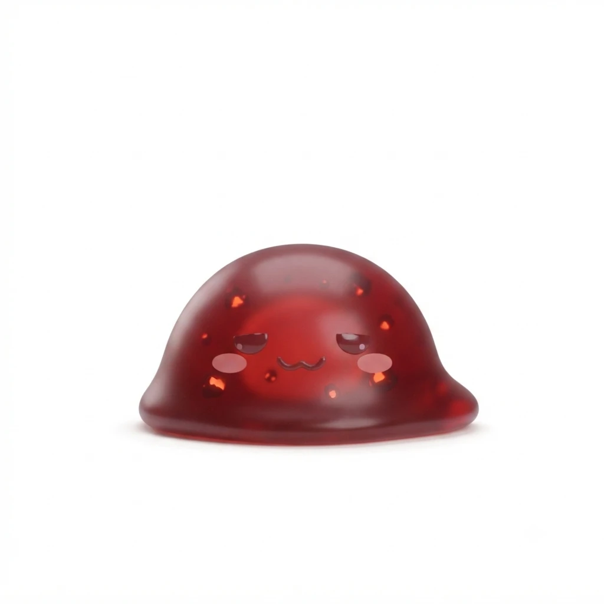
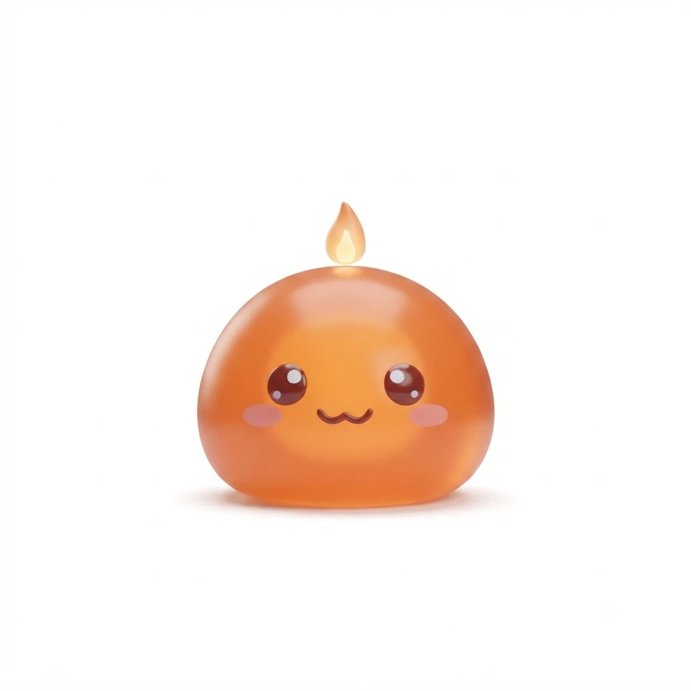
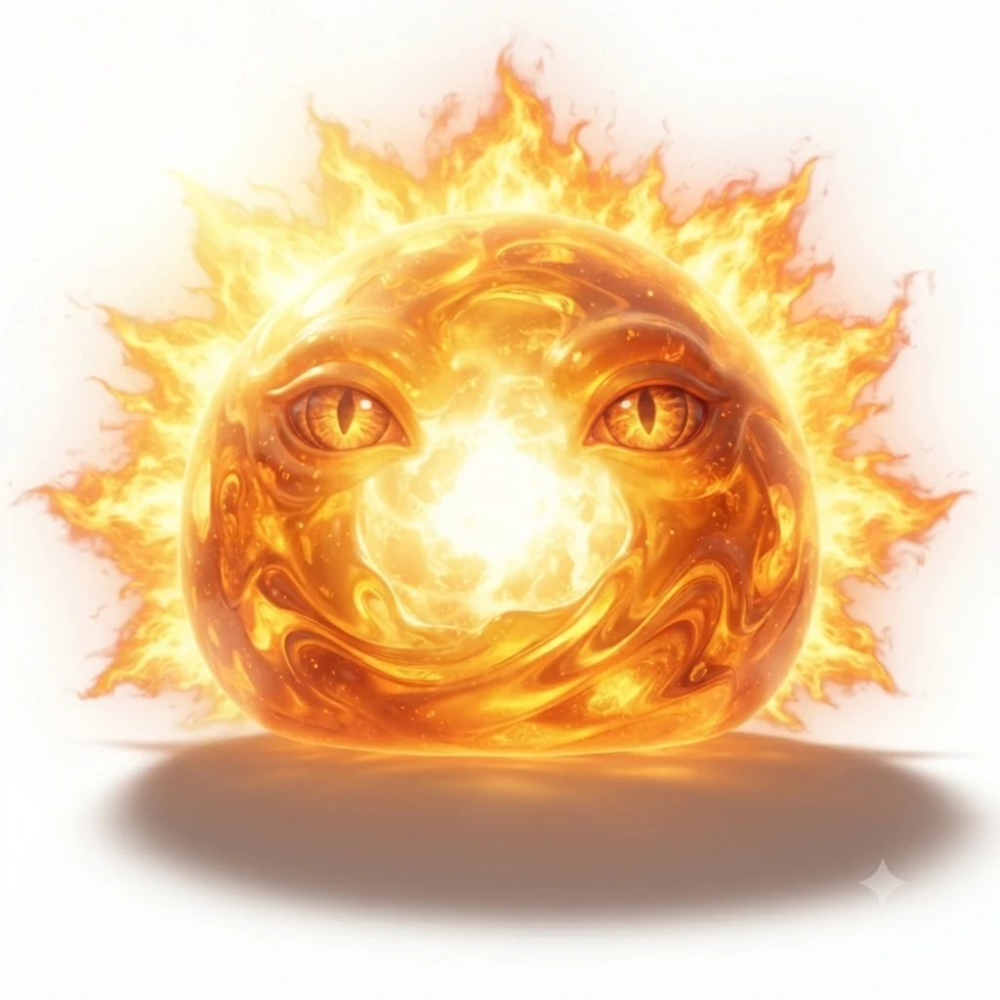
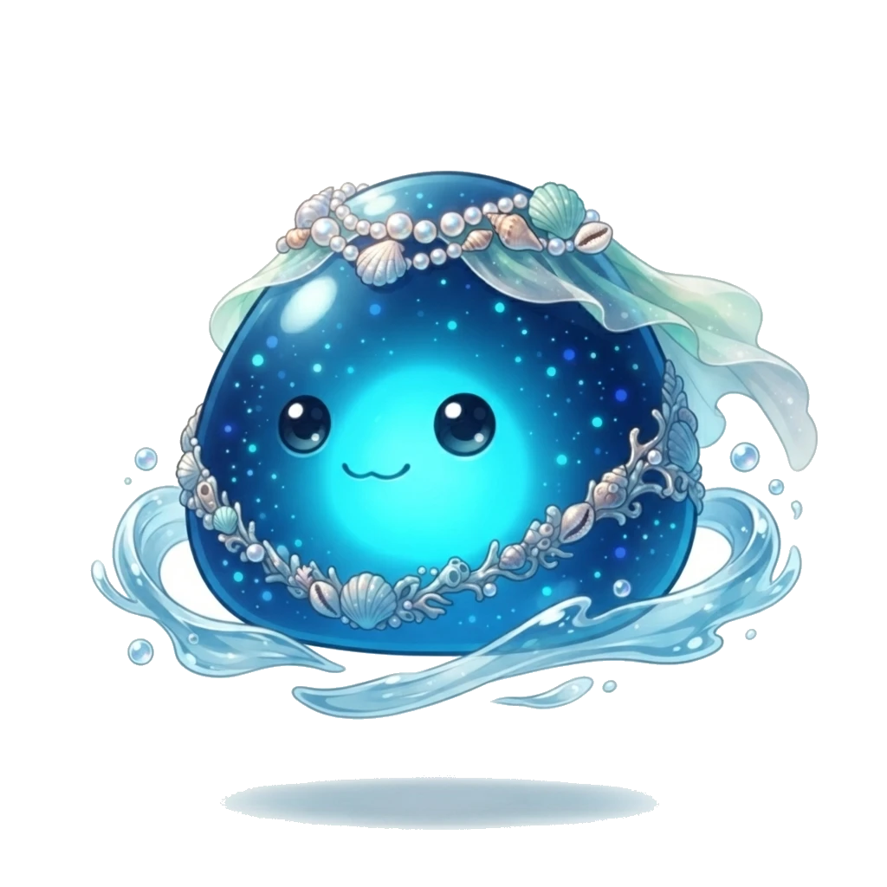

# 카드 아트 Gemini 프롬프트 가이드

컨셉 기획서 v2의 6장(카드 아트 방향)을 실제 생성용 프롬프트로 옮긴 문서입니다.

**방향**: 3D 렌더풍 슬라임(캐릭터 레이어) + 2D 페인팅 배경(배경 레이어) + 플랫 프레임(Unity에서 제작). 입체감은 엔진의 패럴랙스 셰이더와 카드 두께로 만듭니다. 캐릭터 화풍은 등급에 따라 다릅니다. 노말·레어·수퍼레어는 3D 토이풍이고, 유니크·레전더리는 화려한 일러스트풍입니다(1-3 "등급별 화풍").

---

## 0. 작업 순서

1. **스타일 앵커**: `F-N1 불씨 슬라임` 이미지(`images/ref_face_base.webp`)가 50장 전체의 기준(앵커)입니다. 몸 모양, 얼굴, 젤리 질감, 조명을 이 이미지에 맞춥니다.
2. **세션 설정**: Gemini 새 대화를 열고 1-1의 "세션 설정 프롬프트"를 **앵커 이미지와 함께** 보냅니다. 프롬프트만 보내고 이미지를 빼면 화풍과 눈이 흔들립니다.
3. **일괄 생산**: 이후에는 카드별 "주제 줄"만 보냅니다. 한 번에 한 장씩 요청합니다. 스타일이 흔들리면 앵커 이미지를 다시 첨부하고, 줄 끝에 `Same body shape, face and style rules as the anchor.`를 붙입니다.
   - **유니크**를 뽑을 때는 `images/ref_W-U_unique.webp`를, **레전더리**를 뽑을 때는 `images/ref_F-L_legendary.webp`를 함께 첨부합니다. 다른 속성에서는 색과 속성까지 따라 그리지 않도록 `use this only as a reference for style, detail level and scale, not for color or element`라고 덧붙입니다.
4. **누끼 따기**: 캐릭터 레이어의 단색 배경을 제거합니다 (포토샵, remove.bg 등). Gemini에게 "배경을 투명하게"라고 해도 투명 PNG는 잘 나오지 않습니다. 접지 그림자와 빛 번짐 처리는 아래 "누끼 주의점"을 봅니다.
5. **이름 규칙에 맞춰 저장**: 아래 7장의 파일 이름 규칙을 따릅니다.

> 대화가 길어지면 스타일이 흐려집니다. 속성 하나(8장)마다 새 대화를 열고 2번부터 다시 하는 것을 권장합니다.

### 누끼 주의점

아래 세 가지를 정한 뒤 50장 전체에 같은 방식을 적용합니다. 누끼를 딴 이미지는 **어두운 배경과 밝은 배경 위에 각각 올려 보고** 테두리가 남았는지 확인합니다.

| 문제 | 왜 생기나 | 대응 |
| --- | --- | --- |
| 접지 그림자 | 흰 배경 위의 회색 그림자는 누끼를 따면 지워지거나 회색 얼룩으로 남습니다. 장마다 남는 정도가 달라서 카드끼리 통일되지 않습니다 | 누끼 때 그림자는 지우고, Unity에서 같은 그림자 스프라이트를 캐릭터 아래에 깔아 통일하는 방법을 추천합니다 |
| 빛 번짐 (레전더리, 강한 효과) | 흰 배경 위의 밝은 노란빛·흰빛은 배경색과 구분이 안 되어 잘려 나가거나, 흰 테두리가 남습니다 | 빛 번짐은 지우고 또렷한 불꽃·효과만 남긴 뒤, Unity에서 가산(Additive) 글로우 스프라이트로 빛을 다시 얹습니다 |
| Gemini 워터마크 | Gemini는 이미지 오른쪽 아래에 작은 별 모양(✦) 표시를 넣습니다. 프롬프트로는 막을 수 없습니다 | 누끼 때 함께 지웁니다. 그림자나 효과와 겹쳐 있으면 그 부분을 다듬습니다 |

**누끼 시험에서 확인한 것** (F-L, W-U, E-R2)
- 그림자가 누끼 뒤에도 남았고, 장마다 모양이 다릅니다. F-L은 넓고 진한 그림자, W-U는 몸에서 떨어진 그림자(떠 있음), E-R2는 몸에 붙은 그림자입니다. 그대로 쓰면 카드끼리 그림자가 통일되지 않습니다.
- F-L의 불꽃은 잘 남았지만, 불꽃 가장자리에 옅은 흰 테두리가 보입니다. 어두운 카드 배경 위에서 눈에 띄는지 확인이 필요합니다.
- F-L과 W-U의 오른쪽 아래에 워터마크(✦)가 남아 있습니다.

> 공기 속성(어두운 회색 배경)은 반대로 빛 번짐이 회색 테두리로 남기 쉽습니다. 같은 방식으로 처리합니다.

### 이미지 비율

| 레이어 | 비율 | 용도 |
| --- | --- | --- |
| 캐릭터 · 간식 · 전경 소품 | 1:1 | 누끼를 딴 뒤 카드 위에 배치 |
| 창 배경 (노말 · 레어 · 수퍼레어) | 4:3 | 카드 상단의 일러스트 창 |
| 풀아트 배경 (유니크 · 레전더리 · 필드) | 2:3 | 카드 전체를 채움 (5:7로 크롭) |
| 카드 뒷면 | 2:3 | 5:7로 크롭 |

---

## 1. 공통 스타일 블록

### 1-1. 세션 설정 프롬프트 (대화 시작 때 1번)

```text
I'm making original trading card art for a VR game about cute slime creatures.
Follow these rules for every image in this chat unless I say otherwise.
The attached image is the style anchor: copy its body shape, face, jelly material and lighting.
Each request ends with its tier (Normal, Rare, Super rare, Unique or Legendary). Use the tier to pick the style in section 3.

1. BODY (every tier, never change it)
- One soft rounded dome-shaped jelly body, like a gumdrop or mochi: slightly wider than tall, round top, gently flat bottom
- No body parts grow out of the body: no ears, no hair, no arms, no legs, no tail, no neck, no animal or humanoid features
- Small decorations sitting on or attached to the body (horns, crystals, coral, a small fin, little wings, caps, armor) are fine as long as the dome silhouette still reads clearly
- Slight variations are welcome: flatter or puffier proportions, a bottom edge that spreads out softly like a little puddle, a gentle squish or tilt. It must still read as the same dome-shaped slime
- Rarity and element are shown only by color, inner glow, expression, decorations and effects around it, never by changing the silhouette
- Effects (fire, water, wind, rocks) wrap around or float above the body; they never replace or reshape it
- The slime sits on the ground unless I say it floats or jumps

2. FACE (every tier except Legendary; same as the anchor)
- Two round glossy eyes, set wide apart, a little below the middle of the body, the same size as in the anchor
- Eye color: one flat very dark color, dark reddish-brown on warm-colored slimes and dark navy on cool-colored slimes. No visible iris, no gradient, no sparkles inside the eye
- Each eye has exactly two white highlights: a large one at the upper-left and a small one at the lower-right
- A small thin-lined mouth in the same dark color, between and slightly below the eyes (default: a tiny "w" shaped smile)
- A soft pink oval blush under each eye, toward the outside
- Brows only when the expression needs them, short and thin. No eyelashes, no extra face details
- Expressions change only the shape of the eyes and mouth (half-closed, closed happy curves, small angled brows, slightly wider eyes, open mouth). Eye color, highlights, placement, spacing, line thickness and blush stay the same

3. STYLE BY TIER
- Normal, Rare, Super rare: 3D rendered like a glossy collectible vinyl toy, smooth clean surfaces, simple and cute. Never a 2D illustration: no outlines, no brush strokes, no anime drawing
- Unique: a rich polished fantasy illustration. Glossy jelly with painterly detail, ornate decorations, a glowing core and tiny light specks inside the body are welcome. The body and face rules still apply
- Legendary: the same rich illustration style at an epic scale. The eyes may be mythic (glowing, slit pupils, no mouth, no blush), a soft glow from the effect behind the body is allowed, and the contact shadow may be wide and heavy. The body rules still apply
- Every tier: semi-translucent jelly body, mostly opaque, with a slightly brighter inner core; soft specular highlights on the top-left; soft key light from the top-left, soft rim light from the back-right

4. IMAGE
- One character, centered, full body visible, generous margin around it, square 1:1 image
- Plain solid flat background in the color I specify, no gradient, no floor, no scenery
- A small soft contact shadow directly below the creature
- Element effects (fire, water, wind, rocks, sparkles) have crisp clean edges; no smoke, mist or glow haze spreading onto the background (Legendary glow is the only exception)
- No text, no letters, no numbers, no border, no card frame

ITEM and PROP images (when a request starts with "Item:" or "Prop:"):
- An object, not a creature: no face, no eyes, no mouth
- Follow section 3 (style by tier) and section 4 (image rules) the same way as a character image

BACKGROUND images (when a request starts with "Background:"):
- Soft painterly 2D digital painting, gentle gradients, low detail
- Slightly blurred, shallow depth of field so a character can stand in front of it
- Lighting from the top-left, matching the character images
- No characters, no creatures, no animals, no text, no border

FIELD images (when a request starts with "Field:"):
- A painterly 2D landscape that is the main subject of the card: clear, detailed and in focus, not blurred
- Lighting from the top-left, matching the character images
- Keep the lower third simpler and calmer, because card text goes there
- No characters, no creatures, no animals, no text, no border

Avoid: classic pointed-tip teardrop slime shape, slimes wearing crowns, existing game or anime characters, realistic gore, horror.
```

### 1-2. 단독 사용용 블록 (세션 설정 없이 쓸 때 주제 줄 앞에 붙이기)

**캐릭터: 노말 · 레어 · 수퍼레어 (3D 토이풍)**
```text
3D rendered glossy vinyl toy style (not 2D, no outlines), cute original slime creature with one soft rounded dome-shaped jelly body like a gumdrop, no ears, no hair, no limbs, no tail, effects never reshape the body, semi-translucent mostly opaque jelly body, soft specular highlights top-left, two round glossy flat very dark eyes (dark reddish-brown on warm slimes, dark navy on cool slimes, no visible iris) set wide apart a little below the middle with a large upper-left and a small lower-right white highlight, small thin-lined mouth, soft pink blush under each eye, expressions change only the eye and mouth shape, soft key light from top-left, soft rim light, small contact shadow below, centered full body with margin, square 1:1, plain solid flat background, effects with crisp clean edges and no glow haze on the background, no text, no border, no frame.
```

**캐릭터: 유니크 · 레전더리 (화려한 일러스트풍)**
```text
Rich polished fantasy illustration style, glossy jelly with painterly detail, cute original slime creature with one soft rounded dome-shaped jelly body like a gumdrop, no ears, no hair, no limbs, no tail, decorations and effects never reshape the body, semi-translucent mostly opaque jelly body with a glowing core, soft specular highlights top-left, two round glossy flat very dark eyes (dark reddish-brown on warm slimes, dark navy on cool slimes, no visible iris) set wide apart a little below the middle with a large upper-left and a small lower-right white highlight, small thin-lined mouth, soft pink blush under each eye (Legendary tier instead: mythic glowing eyes with slit pupils, no mouth, no blush, soft glow behind the body allowed), soft key light from top-left, soft rim light, contact shadow below, centered full body with margin, square 1:1, plain solid flat background, no text, no border, no frame.
```

**간식 · 전경 소품** (`Item:`, `Prop:` 줄 앞에. 유니크·레전더리는 첫 부분을 `Rich polished fantasy illustration style`로 바꿈)
```text
3D rendered glossy vinyl toy style (not 2D, no outlines), a single object with no face, no eyes and no mouth, soft specular highlights top-left, soft key light from top-left, soft rim light, small contact shadow below, centered with margin, square 1:1, plain solid flat background, effects with crisp clean edges and no glow haze on the background, no text, no border, no frame.
```

**배경** (`Background:` 줄 앞에)
```text
Soft painterly 2D digital painting background, gentle gradients, low detail, slightly blurred depth of field, light from top-left, no characters, no creatures, no text, no border.
```

**필드 풍경** (`Field:` 줄 앞에)
```text
Painterly 2D digital landscape painting as the main subject, clear, detailed and in focus, light from top-left, simpler and calmer lower third, no characters, no creatures, no text, no border.
```

### 1-3. 등급 사다리 (주제 줄에 이미 들어 있음)

| 등급 | 외형 키워드 | 화면 비중 |
| --- | --- | --- |
| 노말 | small, simple round body, minimal features, calm pose | 캐릭터가 이미지의 약 55% |
| 레어 | one distinctive feature (horn, crest, accessory), a few element sparkles | 약 60% |
| 수퍼레어 | 힘이 터지는 순간: 몸 모양은 그대로 + 빛나는 코어 + 몸을 감고 치솟는 이중 효과 + 통통 튀어 오르며 앞으로 기운 자세 + 결의에 찬 눈빛 + slightly low camera angle | 약 70% (효과 포함) |
| 유니크 | majestic, ornate armor or ornaments, glowing core, regal pose | 약 75% |
| 레전더리 | 돔형 몸은 그대로 + 몸 안이 속성 물질로 소용돌이침 + 몸 뒤의 거대한 후광 효과 + 신화적인 눈(입 없음) + 넓고 묵직한 그림자, low camera angle looking up, epic glow | 약 85% (프레임 밖으로 튀어나오게 배치) |

#### 등급별 화풍

| 등급 | 화풍 | 기준 이미지 |
| --- | --- | --- |
| 노말 · 레어 · 수퍼레어 | 3D 토이풍. 매끈하고 단순한 표면, 외곽선과 붓 자국 없음 | `images/ref_face_base.webp` (F-N1, 앵커) |
| 유니크 | 화려한 일러스트풍. 광택 있는 젤리에 세밀한 장식, 몸 안의 빛과 작은 빛 알갱이 | `images/ref_W-U_unique.webp` (W-U) |
| 레전더리 | 유니크와 같은 일러스트풍에 신화적인 규모. 신화적인 눈과 빛 번짐 허용 | `images/ref_F-L_legendary.webp` (F-L) |

주제 줄 끝의 등급 이름(`Normal tier.`, `Unique tier.` 등)이 세션 설정의 화풍을 고르는 표시입니다. **모든 주제 줄에 등급 이름이 들어 있어야 합니다.**

**모든 등급에서 슬라임의 원형(둥근 돔형 젤리)은 같습니다.** 등급 차이는 화풍, 색, 안쪽의 빛, 표정, 장식, 몸 주위의 효과로 냅니다(세션 설정의 1. BODY).

#### 몸 모양 허용 범위



원형을 지키는 선에서 약간의 변형은 허용합니다. 위 이미지(납작하고 바닥이 살짝 퍼진 돔)가 허용 예시입니다.

| 허용 (약간의 변형) | 금지 (원형이 무너짐) |
| --- | --- |
| 납작하거나 통통한 비율 | 세로로 길쭉한 사람형·유령형 몸 |
| 바닥 가장자리가 웅덩이처럼 살짝 퍼짐 | 귀, 머리카락, 팔다리, 꼬리, 목 |
| 살짝 눌리거나 기울어짐 (튀어 오르기, 내려앉기) | 고양이·사자 같은 동물 얼굴형 |
| 몸에 붙은 장식 (뿔, 수정, 작은 날개 등) | 끝이 뾰족한 물방울형 (기존 IP와 닮음) |

#### 얼굴 기본틀



생성할 때마다 눈 디자인이 바뀌는 문제가 있어서, 위 이미지의 얼굴을 기본틀로 고정합니다(세션 설정의 2. FACE). **기본틀은 유지하고, 표정에 따라 눈과 입의 모양만 바꿉니다.**

| 항상 같게 유지 | 표정에 따라 바꿔도 됨 |
| --- | --- |
| 눈 색: 단색의 아주 짙은 색. 따뜻한 색 슬라임은 짙은 적갈색, 차가운 색 슬라임은 짙은 남색 | 눈의 모양 (반쯤 감김, 감은 곡선, 조금 더 크게) |
| 눈 안에 홍채, 그러데이션, 반짝이를 넣지 않음 | 짧고 가는 눈썹 (각도만) |
| 하이라이트 2개 (왼쪽 위 큰 것, 오른쪽 아래 작은 것) | 입 모양 (w 미소, 작게 벌린 입, o 입) |
| 눈의 크기, 위치, 간격 (몸 가운데보다 약간 아래, 넓게) | |
| 가는 선 (입과 눈썹이 굵어지지 않게) | |
| 분홍 볼터치 (눈 아래 바깥쪽) | |

지금까지 뽑은 이미지에서 얼굴이 기본틀과 달랐던 점은 다음과 같습니다. 새 세션 설정은 이 점들을 막도록 썼습니다.

| 이미지 | 기본틀과 다른 점 | 처리 |
| --- | --- | --- |
| E-R2 수정 슬라임 | 눈이 더 크고 홍채 그러데이션과 반짝이가 있음. 눈썹과 입 선이 굵음. 화풍도 2D | 3D 토이풍으로 다시 뽑음 |
| W-U 심해 여왕 | 눈이 짙은 남색, 볼터치 없음 | 그대로 사용. 눈 색은 "차가운 색 슬라임은 짙은 남색"으로 규칙에 반영 |

**표정별 표현** (주제 줄의 표정 부분에 이 영어 표현을 씁니다)

| 표정 | 쓸 표현 |
| --- | --- |
| 기본·행복 | `happy face` (기본틀 그대로) |
| 졸림 | `sleepy half-closed eyes` (눈꺼풀이 위를 덮고, 하이라이트는 아래쪽에 조금 보임) |
| 크게 웃음 | `eyes closed in happy upward curves` (하이라이트 없음) |
| 결의·집중 | `determined eyes with small angled brows`, `small open mouth` |
| 놀람·호기심 | `slightly wider eyes`, `small round "o" mouth` |
| 수줍음 | `eyes glancing to the side`, `stronger blush` |

- 눈썹은 표정에 필요할 때만 짧은 선으로 넣습니다. 굵거나 털이 있는 눈썹은 쓰지 않습니다.
- 예외는 레전더리뿐입니다. 레전더리는 신화적인 눈(세로 동공, 빛나는 눈, 입 없음)을 씁니다.
- 이 이미지가 0장의 스타일 앵커입니다. 세션을 시작할 때 프롬프트와 함께 첨부합니다.

등급마다 겹치지 않는 영역이 있습니다. 레어는 **장식 하나**, 수퍼레어는 **장비 없이 몸에서 터지는 힘**, 유니크는 **갑옷과 속성별 머리 장식이 주는 위엄**, 레전더리는 **거대함과 신화적인 규모**입니다. 수퍼레어 주제 줄에는 majestic, crown, armor, regal을 쓰지 않습니다.

> **왕관은 쓰지 않습니다.** 둥근 몸에 왕관을 얹으면 유명 게임의 왕관 쓴 슬라임과 닮기 쉽습니다. 유니크는 속성 재료로 만든 머리 장식(불꽃과 흑요석, 진주와 조개, 나뭇가지와 꽃, 깃털과 바람)을 쓰고, 줄마다 `(not a crown shape)`를 붙입니다.

### 1-3-1. 수퍼레어 주제 줄 공식

수퍼레어 줄은 두 번 고쳤습니다.

1. **첫 번째 줄** (`energetic ... slime in a dynamic pose, ... swirling around its body`): 레어와 차이가 작았습니다. 효과만 하나 더해졌고, 포즈와 표정도 약했습니다.
2. **두 번째 줄** (`bursting upward in a heroic mid-leap, its jelly body stretched tall, a flame crest flaring from its head, ... mouth open in a battle cry`): 강해지기는 했지만 **슬라임 모양이 무너졌습니다.** 키 큰 유령 같은 몸에 팔다리가 생기거나, 고양이 귀와 머리카락처럼 생긴 불꽃이 붙었고, 2D 일러스트 화풍으로 바뀌기도 했습니다.

원인으로 추정하는 단어는 다음과 같습니다. 이 단어들은 몸 모양을 바꾸므로 쓰지 않습니다.

| 피할 단어 | 실제로 나온 모양 |
| --- | --- |
| `stretched tall`, `heroic` | 사람처럼 키가 크고 팔다리가 생긴 몸 |
| `leap`, `dash` (몸을 설명하지 않고 동작만 쓸 때) | 다리가 생김 |
| `crest flaring from its head` | 머리카락이나 귀처럼 생긴 불꽃 |
| `battle cry` | 송곳니가 드러난 입 |

그래서 공식을 **몸 모양을 먼저 못 박고, 힘은 몸 밖(효과·코어 빛·눈빛·카메라)에서 내는 방식**으로 바꿨습니다.

```text
Character: <색> <속성> slime with the same round soft dome-shaped jelly body as always,
<몸 전체로 하는 동작: hopping up in a powerful bounce with its whole body tilted forward>,
a bright <색> glowing core shining through its body,
a double spiral of <속성 효과> wrapping around its body and rising high above its head,
big round glossy eyes with a determined glint and small angled brows, small open mouth shouting,
<파편> flying outward, slightly low camera angle,
the character and its <속성 효과> fill about 70% of the frame.
The <속성 효과> stays around the body and never changes the body shape.
It has crisp clean edges, no <연기·안개·먼지>, no glow haze on the background.
Super rare tier. Background: <누끼용 배경색>.
```

- **등급 이름만으로는 그림이 강해지지 않습니다.** "Super rare tier"라는 말은 Gemini가 그림으로 바꾸지 못하므로, 무엇을 그릴지 구체적으로 적습니다. 다만 등급 이름은 **지우지 않습니다.** 세션 설정에서 화풍(3D 토이풍 또는 일러스트풍)을 고르는 표시로 쓰기 때문입니다.
- **`the same round soft dome-shaped jelly body as always`와 `never changes the body shape`는 꼭 넣습니다.** 효과가 강해질수록 Gemini가 몸 모양을 바꾸려 합니다.
- **마지막 문장(crisp edges, no haze)도 꼭 넣습니다.** 빛 번짐이 배경까지 퍼지면 누끼를 따기 어려워집니다.
- **2D 화풍이 나오면** 세션 설정 프롬프트와 앵커 이미지를 다시 보냅니다. 새 대화라면 1-2의 3D 토이풍 캐릭터 블록을 줄 앞에 붙입니다. 수퍼레어는 효과가 화려해서 일러스트풍으로 끌려가기 쉽습니다.
- **포즈 대안**: 동작 부분만 기를 모으는 자세로 바꿔 봅니다. `sitting low and squished slightly flatter as if gathering power` + `a tall roaring pillar of spiraling <속성 효과> erupting upward around it`

### 1-3-2. 레전더리 참고 이미지 (F-L 태양 거신 슬라임)



F-L 줄로 뽑은 결과 가운데 기준으로 삼을 만큼 좋은 이미지입니다. 다른 속성의 레전더리도 이 구성을 따릅니다.

| 요소 | 이 이미지에서 | 다른 레전더리에 적용 |
| --- | --- | --- |
| 몸 모양 | 둥근 돔형 그대로이고, 폭이 넓어 묵직함 | 몸 모양 규칙을 지키면서 크기와 무게감으로 신화적인 규모를 냄 |
| 몸 안 | 녹은 금빛 물질이 소용돌이치고, 가운데에 흰빛 코어 | 속성 물질(바닷물, 구름, 은하 등)이 몸 안에서 소용돌이침 |
| 몸 뒤 | 태양의 코로나처럼 사방으로 뻗은 거대한 불꽃 | 몸을 바꾸지 않고, 후광처럼 몸 **뒤에** 큰 효과를 둠 |
| 눈 | 세로 동공의 빛나는 눈, 입 없음 | 귀여운 눈 대신 신화적인 눈. 레전더리에만 허용 |
| 그림자 | 넓고 진한 접지 그림자 | 무게감을 위해 유지 |

**공통 규칙의 레전더리 예외 세 가지** (세션 설정의 3. STYLE BY TIER에 들어 있음)
- **눈 스타일**: 하이라이트 2개인 귀여운 눈 대신 신화적인 눈(세로 동공, 빛나는 눈, 입 없음)을 써도 됩니다.
- **빛 번짐**: 후광 효과의 빛 번짐을 허용합니다. 누끼 처리는 0장의 "누끼 주의점"을 따릅니다.
- **그림자**: 작은 그림자 대신 넓고 진한 그림자를 허용합니다.

> **N-L 원초의 슬라임만 예외입니다 (11/17 결정).** N-L은 캐릭터와 배경을 나누지 않은 **한 장짜리 완성 일러스트**(`BG/N_L_bg.png`, 약 2:3)를 배경 칸에만 넣고, 캐릭터 칸은 비웁니다(`cards.csv`의 char 열이 빈칸). 몸도 돔형이 아니라 세로로 긴 형태라 1. BODY 규칙의 예외입니다. 카드 셰이더가 이미지를 풀아트 영역에 빈틈없이 맞추므로 위아래가 약 4% 잘립니다. 다른 레전더리는 지금처럼 캐릭터 + 배경 2단 구성을 따릅니다.

### 1-3-3. 유니크 참고 이미지 (W-U 심해 여왕 슬라임)



유니크 화풍의 기준 이미지입니다. 다른 속성의 유니크도 이 정도의 세밀함과 화려함을 따릅니다.

| 요소 | 이 이미지에서 | 다른 유니크에 적용 |
| --- | --- | --- |
| 화풍 | 광택 있는 젤리를 세밀하게 그린 일러스트풍 | 3D 토이풍보다 장식과 빛이 풍부함 |
| 머리 장식 | 진주와 조개를 엮은 장식에 얇은 베일. 왕관 모양이 아님 | 속성 재료로 만든 머리 장식 (`not a crown shape`) |
| 몸 안 | 가운데의 밝은 청록빛과 작은 빛 알갱이 | 빛나는 코어와 속성에 맞는 빛 알갱이 |
| 몸 장식 | 조개와 산호를 엮은 띠가 몸을 두름 | 갑옷이나 띠처럼 몸에 두르는 장식. 돔형 실루엣은 유지 |
| 얼굴 | 기본틀의 둥근 눈과 w 미소. 눈은 짙은 남색 | 얼굴 기본틀을 그대로 씀 (레전더리와 다른 점) |

- 이 이미지는 볼터치가 없지만 그대로 씁니다. 새로 뽑는 유니크에는 볼터치를 넣습니다.
- 이 이미지의 슬라임은 물결 위에 떠 있습니다. 세션 설정은 "말하지 않으면 땅에 앉아 있음"이 기본이므로, 떠 있게 하려면 주제 줄에 `floating`을 적습니다.

### 1-4. 속성별 팔레트와 누끼용 배경색

| 속성 | 팔레트 | 몸 질감 | 누끼용 배경색 |
| --- | --- | --- | --- |
| 불 | orange, red, warm yellow | glowing ember jelly | plain solid white |
| 물 | aqua, teal, deep blue | clear jelly with tiny bubbles | plain solid white |
| 땅 | amber, olive green, warm brown | earthy jelly with moss and pebbles | plain solid white |
| 공기 | pale sky blue, white, soft lavender | glossy jelly with soft white cloud swirls inside | plain solid dark gray (#333333) |
| 무속성 | pastel pink, cream, soft peach | classic smooth jelly | plain solid white |

> 공기 속성은 몸이 흰색에 가까워서 흰 배경에서는 누끼가 어렵습니다. 그래서 어두운 회색 배경을 씁니다.

> **공기 속성에서 피할 표현**: `fluffy`, `looks like a cloud`, `made of cloud`. 몸 전체가 울퉁불퉁한 솜 덩어리로 나와서 돔형 실루엣과 젤리 광택이 사라집니다. 구름과 바람은 **몸 안의 무늬**, **머리 위에 얹은 장식**, **몸 주위의 효과**로 표현합니다. 몸 색도 흰색 대신 옅은 하늘색이나 라벤더로 적어야 볼터치와 하이라이트가 보입니다.

---

## 2. 슬라임 카드 40장: 캐릭터 레이어

각 줄을 그대로 복사해 보냅니다. (세션 설정을 안 했다면 1-2의 캐릭터 블록을 앞에 붙입니다.)

> 유니크처럼 장식이 많은 줄에서 몸 모양이 흔들리면(기사처럼 서 있는 몸, 팔이 생긴 몸 등), `Character:` 바로 뒤에 `with the same round soft dome-shaped jelly body as always,`를 넣어 다시 뽑습니다.

### 불 (Fire)

| ID | 등급 | 이름 | 주제 줄 |
| --- | --- | --- | --- |
| F-N1 | 노말 | 불씨 슬라임 | `Character: small round orange slime with a tiny candle-like flame flickering on top of its head, happy smile, calm pose. Normal tier. Background: plain solid white.` |
| F-N2 | 노말 | 숯불 슬라임 | `Character: small slightly flattened dark red slime with glowing coal bits floating inside its body, sleepy half-closed eyes. Normal tier. Background: plain solid white.` |
| F-N3 | 노말 | 꼬마 불꽃 슬라임 | `Character: small round warm yellow slime bouncing in mid-air, a little flame wisp floating behind it like a comet trail, excited face. Normal tier. Background: plain solid white.` |
| F-R1 | 레어 | 화산뿔 슬라임 | `Character: round red-orange slime with two short shiny black obsidian horns and thin glowing lava cracks on its body, confident face, a few ember sparkles around. Rare tier. Background: plain solid white.` |
| F-R2 | 레어 | 갈기불 슬라임 | `Character: round orange slime with a ring of soft little flames floating around its face like a lion's mane (floating flames, not hair), proud smile, a few ember sparkles around. Rare tier. Background: plain solid white.` |
| F-SR | 수퍼레어 | 화염 소용돌이 슬라임 | `Character: orange-red fire slime with the same round soft dome-shaped jelly body as always, hopping up in a powerful bounce with its whole body tilted forward, a bright yellow-white glowing core shining through its body, a double spiral of roaring fire wrapping around its body and rising high above its head, big round glossy eyes with a determined fiery glint and small angled brows, small open mouth shouting, many embers and sparks flying outward, slightly low camera angle, the character and its fire fill about 70% of the frame. The fire stays around the body and never changes the body shape. The fire has crisp clean edges, no smoke, no glow haze on the background. Super rare tier. Background: plain solid white.` |
| F-U | 유니크 | 용암 군주 슬라임 | `Character: majestic large red slime wearing an ornate fire headpiece of molten gold flames and small black obsidian shards resting on top of its head (not a crown shape), ornate black obsidian armor plates on its sides, glowing bright lava core visible inside, regal calm expression. Unique tier. Background: plain solid white.` |
| F-L | 레전더리 | 태양 거신 슬라임 | `Character: colossal mythic fire slime shaped like a living sun, a blazing corona of flames radiating around it, molten golden body with a white-hot core, wise powerful eyes, low camera angle looking up, epic scale. Legendary tier. Background: plain solid white.` |

### 물 (Water)

| ID | 등급 | 이름 | 주제 줄 |
| --- | --- | --- | --- |
| W-N1 | 노말 | 물방울 슬라임 | `Character: small round clear aqua slime with tiny bubbles inside, gentle smile, calm pose. Normal tier. Background: plain solid white.` |
| W-N2 | 노말 | 거품 슬라임 | `Character: small round light blue slime blowing a soap bubble from its mouth, many tiny bubbles inside its body, playful face. Normal tier. Background: plain solid white.` |
| W-N3 | 노말 | 이슬 슬라임 | `Character: tiny round teal slime sitting on a big green leaf, a single dewdrop balanced on its head, shy face. Normal tier. Background: plain solid white.` |
| W-R1 | 레어 | 산호뿔 슬라임 | `Character: round deep aqua slime with two short, soft coral nubs sprouting out of the top of its head as part of its own jelly body, made of the same glossy semi-translucent jelly, the color gradually shifting from aqua at the base to soft coral pink at the rounded tips, the base melting smoothly into the body with no seam, each nub with only two or three tiny rounded bumps (not deer antlers, not sharp branches), a few tiny pink coral specks floating inside the body, cheerful face, a few water sparkles around. Rare tier. Background: plain solid white.` |
| W-R2 | 레어 | 물보라 슬라임 | `Character: round blue slime with a fin-shaped crest on its head and little splashing water droplets around it, lively face. Rare tier. Background: plain solid white.` |
| W-SR | 수퍼레어 | 파도타기 슬라임 | `Character: teal water slime with the same round soft dome-shaped jelly body as always, riding the crest of a big curling wave with its whole body tilted forward, a bright cyan glowing core shining through its clear body, a double spiral of rushing water wrapping around its body and arcing high above its head, big round glossy eyes with a determined glint and small angled brows, small open mouth shouting with joy, many water droplets and spray bursting outward, slightly low camera angle, the character and its water fill about 70% of the frame. The water stays around the body and never changes the body shape. The water has crisp clean edges, no mist, no glow haze on the background. Super rare tier. Background: plain solid white.` |
| W-U | 유니크 | 심해 여왕 슬라임 | `Character: majestic large deep blue slime wearing a delicate sea headpiece of pearls, small seashells and a flowing sea-foam veil resting on top of its head (not a crown shape), ornate seashell armor, soft bioluminescent dots glowing across its body, glowing cyan core, graceful regal expression. Unique tier. Background: plain solid white.` |
| W-L | 레전더리 | 대해신 슬라임 | `Character: colossal mythic water slime with a wide round dome-shaped jelly body, deep ocean currents swirling inside its glowing deep blue body around a bright cyan core, a giant whirlpool spiraling behind it like a halo with great arcs of water rising like the fins of a sea leviathan, ancient calm glowing eyes, no mouth, wide heavy contact shadow, low camera angle looking up, epic scale. Legendary tier. Background: plain solid white.` |

### 땅 (Earth)

| ID | 등급 | 이름 | 주제 줄 |
| --- | --- | --- | --- |
| E-N1 | 노말 | 진흙 슬라임 | `Character: small round warm brown slime with a soft matte mud texture and a few drips, sleepy content face. Normal tier. Background: plain solid white.` |
| E-N2 | 노말 | 이끼 슬라임 | `Character: small round olive green slime with a soft patch of moss and a tiny sprout on top of its head, gentle smile. Normal tier. Background: plain solid white.` |
| E-N3 | 노말 | 조약돌 슬라임 | `Character: small round amber slime with several smooth colorful pebbles visible inside its body, curious face. Normal tier. Background: plain solid white.` |
| E-R1 | 레어 | 버섯갓 슬라임 | `Character: round amber slime wearing a big red-and-cream spotted mushroom cap like a hat, happy face, a few spore sparkles around. Rare tier. Background: plain solid white.` |
| E-R2 | 레어 | 수정 슬라임 | `Character: round olive-brown slime with small shiny amber crystals poking out of its back, proud face, a few glints around. Rare tier. Background: plain solid white.` |
| E-SR | 수퍼레어 | 대지 울림 슬라임 | `Character: warm brown earth slime with the same round soft dome-shaped jelly body as always, landing hard on the ground with a heavy stomp, its body squished slightly wider from the impact, a warm amber glowing core shining through its body, a double spiral of broken rock chunks blasting upward and circling around its body, big round glossy eyes with a determined glint and small angled brows, small open mouth shouting, pebbles and small rock shards flying outward, slightly low camera angle, the character and its rocks fill about 70% of the frame. The rocks stay around the body and never change the body shape. The rocks have crisp clean edges, no dust cloud, no glow haze on the background. Super rare tier. Background: plain solid white.` |
| E-U | 유니크 | 고목 수호자 슬라임 | `Character: majestic large green-brown slime wearing ornate armor of ancient tree bark and a forest headpiece of a small twisted branch with fresh leaves and tiny blossoms resting on top of its head (not a crown shape), glowing amber core, wise regal expression. Unique tier. Background: plain solid white.` |
| E-L | 레전더리 | 산맥 거신 슬라임 | `Character: colossal mythic earth slime carrying a whole small mountain range with forests and a waterfall on its back, glowing amber core deep inside, ancient gentle eyes, low camera angle looking up, epic scale. Legendary tier. Background: plain solid white.` |

### 공기 (Air)

| ID | 등급 | 이름 | 주제 줄 |
| --- | --- | --- | --- |
| A-N1 | 노말 | 솜구름 슬라임 | `Character: small round pale sky blue slime with a glossy jelly body, a soft white cloud-like puff resting on top of its head like a little hat, faint white cloud swirls visible inside its body, dreamy smile with half-closed eyes. Normal tier. Background: plain solid dark gray #333333.` |
| A-N2 | 노말 | 산들바람 슬라임 | `Character: small round pale sky blue slime with two little white wind swirl wisps curling around it, relaxed happy face. Normal tier. Background: plain solid dark gray #333333.` |
| A-N3 | 노말 | 풍선 슬라임 | `Character: small extra-round puffed-up lavender slime floating a little above the ground like a balloon (no string, no knot), slightly wider eyes and a small round "o" mouth. Normal tier. Background: plain solid dark gray #333333.` |
| A-R1 | 레어 | 깃털 슬라임 | `Character: round pale blue slime with two small white feather wings attached to its sides, floating just above the ground, cheerful face, a few sparkles around. Rare tier. Background: plain solid dark gray #333333.` |
| A-R2 | 레어 | 회오리꼬리 슬라임 | `Character: round lavender slime riding on top of a small spinning white tornado, tilted playfully, happy face, a few sparkles around. Rare tier. Background: plain solid dark gray #333333.` |
| A-SR | 수퍼레어 | 폭풍 질주 슬라임 | `Character: sky blue air slime with the same round soft dome-shaped jelly body as always, zooming forward through the air with its whole body tilted forward, a bright white glowing core shining through its body, a double spiral of sharp wind ribbons wrapping around its body and trailing far behind it, big round glossy eyes with a focused glint and small angled brows, small open mouth shouting, sharp gale streaks and small sparkles flying outward, slightly low camera angle, the character and its wind fill about 70% of the frame. The wind stays around the body and never changes the body shape. The wind ribbons have crisp clean edges, no fog, no glow haze on the background. Super rare tier. Background: plain solid dark gray #333333.` |
| A-U | 유니크 | 천공 기사 슬라임 | `Character: majestic large pale blue slime wearing an ornate silver band of wind-pattern armor around its body and a sky headpiece of a few swept-back white feathers with small silver wind swirls resting on top of its head (not a crown shape), a pair of ornate white feather wing ornaments attached to its sides, floating above the ground with soft wind ribbons circling below it, glowing soft white core, calm noble expression. Unique tier. Background: plain solid dark gray #333333.` |
| A-L | 레전더리 | 하늘고래 슬라임 | `Character: colossal mythic air slime with a wide round dome-shaped cloud jelly body, soft clouds and aurora light swirling inside it around a glowing lavender core, behind it a huge faint sky whale silhouette formed from clouds and aurora ribbons like a halo, serene ancient glowing eyes, no mouth, wide heavy contact shadow, low camera angle looking up, epic scale. Legendary tier. Background: plain solid dark gray #333333.` |

### 무속성 (Neutral)

| ID | 등급 | 이름 | 주제 줄 |
| --- | --- | --- | --- |
| N-N1 | 노말 | 말랑 슬라임 | `Character: small round classic pastel pink slime, smooth glossy body, warm happy smile, calm pose. Normal tier. Background: plain solid white.` |
| N-N2 | 노말 | 졸린 슬라임 | `Character: small slightly squished cream-colored slime dozing off, closed eyes, tiny bubble from its nose. Normal tier. Background: plain solid white.` |
| N-N3 | 노말 | 아기 슬라임 삼형제 | `Character: three tiny round pastel slimes (pink, peach, cream) huddled together in a row, cute surprised faces. Normal tier. Background: plain solid white.` |
| N-R1 | 레어 | 리본 슬라임 | `Character: round pastel pink slime with a big glossy ribbon bow on top of its head, sweet smile, a few sparkles around. Rare tier. Background: plain solid white.` |
| N-R2 | 레어 | 무지갯빛 슬라임 | `Character: round cream slime with a soft iridescent rainbow sheen across its glossy body, delighted face, a few sparkles around. Rare tier. Background: plain solid white.` |
| N-SR | 수퍼레어 | 분열 슬라임 | `Character: peach slime with the same round soft dome-shaped jelly body as always, bouncing up as two smaller copies of itself pop out beside it, all three with the same dome shape, a bright warm glowing core shining through each body, thin glowing jelly strands of light connecting them, a double spiral of glossy jelly droplets wrapping around the group, big round glossy eyes with a mischievous confident glint, small open mouths shouting, sparkles bursting outward, slightly low camera angle, the group fills about 70% of the frame. The droplets stay around the bodies and never change their shape. The droplets have crisp clean edges, no glow haze on the background. Super rare tier. Background: plain solid white.` |
| N-U | 유니크 | 프리즘 현자 슬라임 | `Character: majestic large pastel slime with a glowing prism crystal core inside, two floating ornate rune rings orbiting around it, small wise glasses, calm regal expression. Unique tier. Background: plain solid white.` |
| N-L | 레전더리 | 원초의 슬라임 | `Character: colossal mythic primordial slime, the origin of all slimes, with the same round soft dome-shaped jelly body as always, wide and heavy, its soft base spreading slightly on the ground. Soft matte milky pearl-white jelly with a velvety satin surface like ancient moonstone, no glossy specular highlights and no wet shine on the surface (this overrides the usual top-left highlights), still semi-translucent and glowing from within, so the only bright light comes from inside: a blinding pearly white core of first light in the center, and five thin swirling wisps of pastel color (warm orange, aqua blue, olive green, pale sky blue, soft pink) spiraling out of the core like elements being born, asymmetric and never forming a face or smile shape, with tiny starlight specks drifting inside. Behind the body like a halo, a vast radiant burst of pearly light rays crossed by five great arcs of pastel elemental light, like the first dawn of creation. Two eyes that are not separate eyeballs but shapes formed in the jelly surface itself: each is a slightly recessed round hollow with three or four engraved concentric ripple rings and a small round center, like a ripple frozen in the jelly, the same pearl-white material and color as the body, matte, no glossy eyeball, no iris color, no highlights, no eyelids, no brows, no wrinkles or ridges around them, set high and wide on the upper body, the rings centered so the slime stares straight down at the viewer from above with a calm, heavy, overwhelming gaze, no slanted sockets that look angry or sad, no mouth. Slight three-quarter view: the body is turned a little toward the viewer's left and gently tilted, so the eye on the viewer's right looks slightly larger and higher. The halo stays behind the body and never changes the body shape. Wide heavy contact shadow, low camera angle looking up, epic scale. Legendary tier. Background: plain solid dark gray #333333.` |

---

## 3. 슬라임 카드 배경 레이어

노말·레어는 속성별 공용 배경 1장을 씁니다. 수퍼레어 이상은 카드마다 따로 만듭니다. (총 25장)

### 3-1. 공용 창 배경 (노말 · 레어, 4:3)

| ID | 속성 | 주제 줄 |
| --- | --- | --- |
| BG-F-W | 불 | `Background: a warm volcanic meadow with smooth reddish rocks, gentle distant volcano, warm orange and red sky, soft glowing embers in the air. Landscape 4:3.` |
| BG-W-W | 물 | `Background: a calm tide pool beach with clear turquoise water, smooth stones and shells, bright aqua sky. Landscape 4:3.` |
| BG-E-W | 땅 | `Background: a mossy forest floor with soft mushrooms, ferns and warm sunbeams through trees, amber and olive tones. Landscape 4:3.` |
| BG-A-W | 공기 | `Background: a soft pastel sky above fluffy clouds, gentle wind swirls, pale blue and lavender tones. Landscape 4:3.` |
| BG-N-W | 무속성 | `Background: a cozy sunny grass meadow with small flowers, soft pastel pink and cream sky. Landscape 4:3.` |

### 3-2. 수퍼레어 창 배경 (4:3)

| ID | 주제 줄 |
| --- | --- |
| F-SR-BG | `Background: inside a glowing volcano crater with rivers of lava and rising heat, dramatic orange and red light. Landscape 4:3.` |
| W-SR-BG | `Background: open ocean with big rolling waves under a bright sky, sparkling spray, aqua and deep blue tones. Landscape 4:3.` |
| E-SR-BG | `Background: a rocky canyon with cracked ground and floating dust in warm sunlight, amber and brown tones. Landscape 4:3.` |
| A-SR-BG | `Background: high in a windy sky among speeding clouds with streaks of wind, pale blue and white tones. Landscape 4:3.` |
| N-SR-BG | `Background: a whimsical pastel playground of soft jelly hills and bouncy shapes, pink and cream tones. Landscape 4:3.` |

### 3-3. 유니크 · 레전더리 풀아트 배경 (2:3)

풀아트는 카드 전체를 채우므로 **아래 1/3은 비교적 단순하게** 둡니다. 그 위에 이름과 정보 텍스트가 올라갑니다.

| ID | 주제 줄 |
| --- | --- |
| F-U-BG | `Background: a grand throne hall carved from black obsidian with lava waterfalls glowing behind, warm dramatic light, simpler darker lower third. Portrait 2:3.` |
| F-L-BG | `Background: an epic sky above an erupting volcano with a blazing sunset and glowing clouds, radiant golden light from the center, simpler lower third. Portrait 2:3.` |
| W-U-BG | `Background: a serene deep sea palace with coral pillars, glowing jellyfish and light rays from above, deep blue tones, simpler lower third. Portrait 2:3.` |
| W-L-BG | `Background: a vast stormy ocean with a gigantic whirlpool and a beam of light breaking through the clouds, epic scale, simpler lower third. Portrait 2:3.` |
| E-U-BG | `Background: an ancient sacred forest with a giant old tree, floating glowing pollen and soft god rays, simpler lower third. Portrait 2:3.` |
| E-L-BG | `Background: an epic wide valley with towering mountains, forests and waterfalls under a golden sky, epic scale, simpler lower third. Portrait 2:3.` |
| A-U-BG | `Background: a floating sky castle among white clouds with silver banners in the wind, bright soft light, simpler lower third. Portrait 2:3.` |
| A-L-BG | `Background: a vast night-to-dawn sky filled with aurora ribbons above a sea of clouds, epic scale, simpler lower third. Portrait 2:3.` |
| N-U-BG | `Background: a quiet mystical library tower with floating books and soft prism light beams, pastel tones, simpler lower third. Portrait 2:3.` |
| N-L-BG | `Background: deep space with a colorful pastel nebula, swirling galaxies and soft starlight, a large soft pastel rainbow halo arc glowing in the upper center, faint drifting cosmic dust, epic scale, simpler lower third. Portrait 2:3.` |

---

## 4. 환경 필드 카드 5장

필드 카드는 슬라임이 없는 풍경 카드입니다. 수퍼레어 이상은 **먼 배경 + 가까운 전경 소품**을 따로 뽑아 패럴랙스에 씁니다.

- **풍경은 `Field:`로 시작합니다.** 슬라임 카드의 배경(`Background:`)은 캐릭터 뒤에 깔리므로 흐릿하고 단순하게 그리지만, 필드 카드는 풍경이 주인공이라 또렷하고 세밀해야 합니다. 그래서 세션 설정에 FIELD 규칙을 따로 두었습니다.
- **전경 소품은 `Prop:`으로 시작합니다.** 얼굴이 없는 물체이고, 화풍은 슬라임과 같이 등급을 따릅니다(수퍼레어는 3D 토이풍, 유니크·레전더리는 일러스트풍). 누끼를 따서 풍경 위에 올립니다.
- 필드 카드는 카드 전체를 채우는 풀아트라서, 풍경의 **아래 1/3은 단순하게** 둡니다. 그 위에 이름과 정보 텍스트가 올라갑니다.
- 전경 소품이 있는 풍경에는 소품이 들어갈 **빈자리**를 남깁니다(`open empty ... in the lower middle`).
- 소품의 빛은 소품 안에만 두고 배경으로 번지지 않게 합니다. 흰 배경에서 빛 번짐은 누끼 때 사라집니다.

| ID | 등급 | 이름 | 레이어 | 주제 줄 |
| --- | --- | --- | --- | --- |
| FD-N | 노말 | 슬라임 들판 | 1장 | `Field: a peaceful green meadow with soft rolling hills under a clear morning sky, tiny colorful jelly droplets glistening on the grass, a calm and simple scene, simpler lower third. Portrait 2:3.` |
| FD-R | 레어 | 이슬 숲 | 1장 | `Field: a misty forest path with sparkling dewdrops on every leaf, gentle light rays through the trees, soft green and teal tones, simpler lower third. Portrait 2:3.` |
| FD-SR | 수퍼레어 | 반딧불 버섯 동굴 | 먼 배경 | `Field: a dark cozy cave with many glowing blue and purple mushrooms deep inside and drifting firefly lights, magical glow lighting the cave walls, open empty ground in the lower middle for a foreground object, simpler lower third. Portrait 2:3.` |
| | | | 전경 | `Prop: a cluster of three large mushrooms with softly glowing blue and purple caps, the glow stays inside the caps with no haze on the background. Super rare tier. Background: plain solid white.` |
| FD-U | 유니크 | 떠다니는 구름섬 | 먼 배경 | `Field: a wide pastel sky with distant floating islands and long waterfalls pouring into a sea of clouds, soft golden light, open empty sky in the lower middle for a foreground object, simpler lower third. Portrait 2:3.` |
| | | | 전경 | `Prop: a small grassy floating island with a little tree, hanging roots underneath and a short waterfall trailing off its edge, ornate and detailed, floating with no shadow below. Unique tier. Background: plain solid white.` |
| FD-L | 레전더리 | 슬라임 성지 | 먼 배경 | `Field: an ancient sacred sanctuary with tall stone arches, a huge glowing rainbow jelly crystal in the center, divine light rays from above, epic scale, open empty ground in the lower middle for a foreground object, simpler lower third. Portrait 2:3.` |
| | | | 전경 | `Prop: two broken ancient stone pillars with soft moss and small glowing rainbow jelly crystals growing on them, epic and detailed, the glow stays inside the crystals with no haze on the background. Legendary tier. Background: plain solid white.` |

---

## 5. 간식(아이템) 카드 5장

간식은 `Item:`으로 시작합니다. 배경은 무속성 공용 배경(`BG-N-W`)을 같이 씁니다.

- **간식에는 얼굴이 없습니다.** 세션 설정에 "Item과 Prop은 얼굴 없음"을 넣었습니다. 슬라임 얼굴 규칙을 따라 쿠키에 눈이 생기는 것을 막습니다.
- **화풍은 슬라임과 같이 등급을 따릅니다.** 노말·레어·수퍼레어는 3D 토이풍, 유니크·레전더리는 화려한 일러스트풍입니다. 그래서 줄마다 적혀 있던 `3D rendered glossy toy style`과 조명·그림자 문구는 뺐습니다. 세션 설정이 등급 이름을 보고 정합니다.
- **등급 차이**는 슬라임과 같은 방식으로 냅니다. 노말은 단순하게, 레어는 반짝임 조금, 수퍼레어는 몸을 감는 이중 효과, 유니크는 화려한 장식, 레전더리는 신화적인 규모입니다.
- 레전더리의 `soft halo of light`는 뺐습니다. 흰 배경 위의 후광은 누끼 때 사라지므로, 빛이 필요하면 Unity에서 얹습니다.

| ID | 등급 | 이름 | 주제 줄 |
| --- | --- | --- | --- |
| SN-N | 노말 | 젤리빈 한 줌 | `Item: a small pile of glossy colorful jelly beans, simple and cute. Normal tier. Background: plain solid white.` |
| SN-R | 레어 | 꿀방울 쿠키 | `Item: a round golden cookie with shiny honey drops on top, a few sparkles around. Rare tier. Background: plain solid white.` |
| SN-SR | 수퍼레어 | 무지개 푸딩 | `Item: a wobbly layered rainbow jelly pudding on a small plate with a cherry on top, translucent layers with a bright glowing center, jiggling with energy, a double spiral of rainbow sparkles swirling around it, the sparkles have crisp clean edges with no glow haze on the background. Super rare tier. Background: plain solid white.` |
| SN-U | 유니크 | 별가루 마카롱 탑 | `Item: an elegant tower of pastel macarons dusted with glittering star powder on an ornate golden stand, tiny stars floating around it, rich and regal presentation. Unique tier. Background: plain solid white.` |
| SN-L | 레전더리 | 별의 꿀단지 | `Item: a grand ornate golden honey pot overflowing with glowing cosmic honey that holds a swirling galaxy of tiny stars, ribbons of starlight rising from it, low camera angle looking up, epic presentation. Legendary tier. Background: plain solid white.` |

---

## 6. 카드 뒷면 1장

기획서 6장: "중앙 심볼 + 대칭 패턴" 구조만 참고하고, 중앙에는 슬라임 얼굴을 둡니다.

```text
Flat 2D vector graphic design for the back of a trading card. Perfectly symmetrical layout.
In the center, a simple cute slime face emblem (round jelly shape with two big glossy eyes and a small smile) inside a circular badge.
Around it, a symmetrical pattern of soft radiating rays and small droplet shapes.
Color scheme: deep violet and teal gradient with a warm gold outline accent.
Clean crisp shapes, no text, no letters, no logo of any existing brand, no border. Portrait 2:3.
```

> 카드 뒷면은 패턴이 정확하게 대칭이어야 해서, Gemini 결과를 바탕으로 직접 다듬는 것이 더 빠를 수 있습니다.

---

## 7. 파일 이름 규칙

```text
Assets/<아트 폴더>/Cards/
  Char/   F_N1_char.png, F_L_char.png, SN_R_char.png, FD_SR_fg.png ...
  BG/     BG_F_W.png, F_SR_bg.png, F_U_bg.png, FD_L_bg.png ...
  Back/   card_back.png
```

- ID의 `-`를 `_`로 바꿔 파일 이름으로 씁니다. 이 ID는 카드 데이터 테이블(기획서 5-7)의 카드 ID와 똑같이 맞춥니다.
- 저장 해상도는 1024px 기준으로 하고, Quest 빌드에서 ASTC 압축을 씁니다.

---

## 8. 품질 체크리스트 (매 장마다)

- [ ] 슬라임 원형(둥근 돔형)이 유지되는가? 1-3의 "몸 모양 허용 범위" 표로 판단합니다. (납작함·퍼진 바닥·장식은 괜찮고, 팔다리·귀·길쭉한 몸은 안 됨)
- [ ] 화풍이 등급에 맞는가? 노말·레어·수퍼레어는 3D 토이풍(외곽선과 붓 자국 없음), 유니크·레전더리는 일러스트풍입니다. 어긋나면 세션 설정과 앵커 이미지를 다시 보냅니다.
- [ ] 눈 안에 홍채, 그러데이션, 반짝이가 들어가지 않았는가? 눈썹과 입 선이 굵어지지 않았는가?
- [ ] 오른쪽 아래의 Gemini 워터마크(✦)를 지웠는가?
- [ ] 간식과 전경 소품에 얼굴(눈, 입)이 생기지 않았는가?
- [ ] 필드 풍경이 흐릿하지 않고 또렷한가? 아래 1/3이 텍스트를 올릴 만큼 단순한가? 전경 소품이 들어갈 빈자리가 있는가?
- [ ] 공기 속성 슬라임이 솜 덩어리가 아니라 광택 있는 젤리 몸인가?
- [ ] 조명이 왼쪽 위에서 오는가? (하이라이트 위치 확인)
- [ ] 얼굴이 1-3의 "얼굴 기본틀"과 같은가? 눈 색, 하이라이트 2개의 위치, 눈 위치와 간격, 볼터치를 확인합니다. (표정에 따른 눈·입 모양 변화는 괜찮음)
- [ ] 몸이 너무 투명해서 배경이 비쳐 보이지 않는가? (누끼가 깨짐)
- [ ] 효과(불·물·바람)의 빛 번짐이나 연기가 배경까지 퍼지지 않았는가? (누끼가 깨짐. 레전더리는 허용하되 0장 "누끼 주의점"대로 처리)
- [ ] 레전더리가 아닌데 세로 동공 같은 신화적인 눈이 나오지 않았는가?
- [ ] 이미지 안에 글자, 테두리, 카드 프레임이 들어가 있지 않은가?
- [ ] 캐릭터가 잘리지 않고 여백이 있는가? (레전더리는 프레임 밖으로 튀어나오게 배치하므로 여백이 특히 중요)
- [ ] 기존 IP와 닮지 않았는가? 특히 **끝이 뾰족한 물방울형 슬라임**, 파란 물방울형 주인공 슬라임, 왕관 쓴 거대 슬라임 같은 유명 디자인은 피합니다.
- [ ] 같은 속성 8장을 나란히 놓았을 때 등급 차이가 그림만 봐도 보이는가? 특히 레어와 수퍼레어를 나란히 놓고, 수퍼레어의 몸 자체가 달라 보이는지 확인합니다.
- [ ] 수퍼레어에 왕관이나 갑옷이 들어가지 않았는가? (유니크와 겹침)
- [ ] 유니크의 머리 장식이 왕관 모양(둥근 띠 위에 뾰족한 끝이 솟은 모양)으로 나오지 않았는가?

## 9. 생성 수량 요약

| 구분 | 장수 |
| --- | --- |
| 슬라임 캐릭터 | 40 |
| 슬라임 배경 (공용 5 + 수퍼레어 5 + 풀아트 10) | 20 |
| 필드 카드 (배경 5 + 전경 3) | 8 |
| 간식 캐릭터 | 5 |
| 카드 뒷면 | 1 |
| **합계** | **74** (재생성 제외) |
