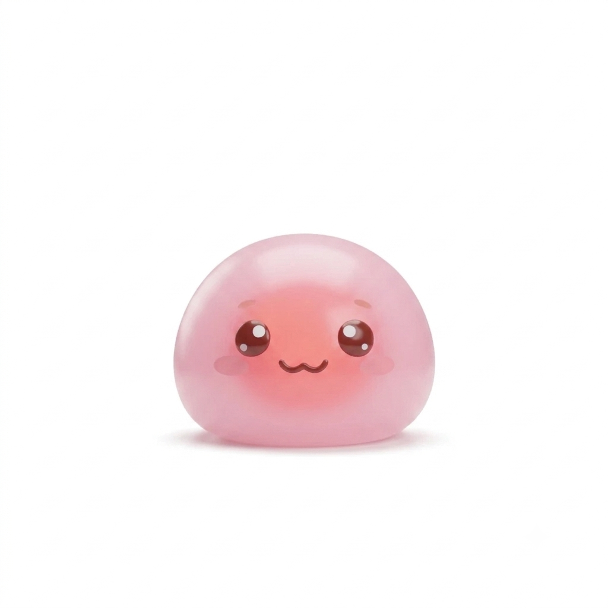
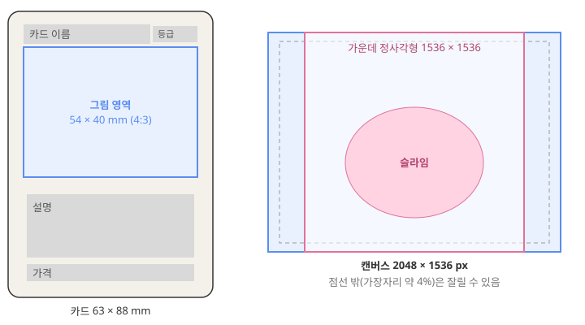
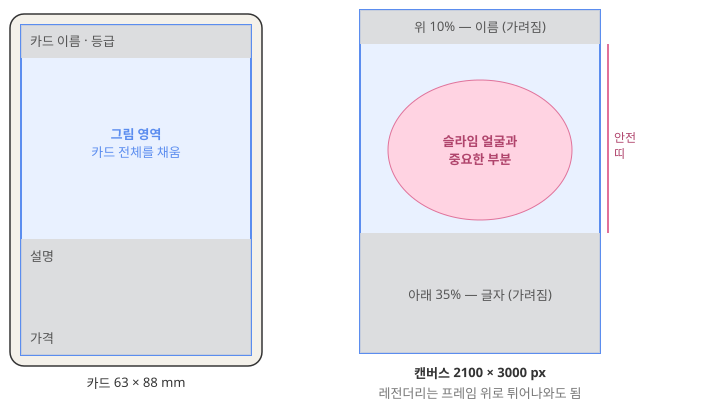

# 슬라임 카드 아트 제작 가이드

*퇴근하고 한 팩* (VR, Meta Quest) — 카드 50장

카드 50장의 컨셉과, 50장이 한 세트처럼 보이게 하는 규칙을 정리한 문서입니다. 화풍은 자유이고, 아래 규칙은 몸 모양 · 배치 · 파일 규격만 다룹니다.

- 결정 경위: DEC-009 (카드 구성 변경), 11-20 재결정 — 아트는 직접 제작
- 영문판: `카드아트_일러스트_요청서_EN.md` (같은 내용, 외주용으로 쓰던 것)
- 이전 방식: `카드아트_Gemini_프롬프트_가이드.md` — 카드 컨셉이 바뀌기 전 기준이므로 카드별 주제 줄은 이 문서의 6~8장으로 다시 써야 합니다

---

## 1. 게임에서 카드가 보이는 모습

- 플레이어는 VR에서 카드를 손에 들고 봅니다. 카드는 실제 트레이딩 카드 크기 **63 × 88 mm** 입니다.
- 이 크기에서는 세밀한 묘사보다 **또렷한 모양과 분명한 색**이 잘 보입니다. 특히 노말 카드는 단순할수록 좋습니다.
- 카드 테두리, 이름, 등급 표시, 가격은 게임이 그립니다. **그림에 글자 · 테두리 · 프레임을 넣지 않습니다.**
- 슬라임과 배경은 두 레이어로 따로 보여서, 카드를 기울이면 슬라임이 배경 앞에 살짝 떠 보입니다(입체 효과). 5장을 봅니다.

---

## 2. 슬라임 핵심 규칙

반드시 지킬 규칙은 이것뿐입니다.

### 기준 모양 (11-20 확정)



모든 슬라임의 몸과 얼굴은 이 그림(N-N1 말랑 슬라임)을 기준으로 합니다.

| 부분 | 기준 |
| --- | --- |
| 실루엣 | 폭이 높이의 약 1.2배인 돔. 위는 크게 둥글고, 옆면은 거의 곧게 내려오다가 **바닥 가장자리에서 살짝 안으로 말려 들어가** 평평한 바닥에 닿음 (찹쌀떡 · 구미 젤리) |
| 질감 | 반투명 젤리, 대부분 불투명. 가운데가 안에서 은은하게 더 밝게 빛남. 왼쪽 위에 부드러운 광택 |
| 눈 | 몸 높이의 가운데보다 조금 아래, 폭의 약 40%만큼 떨어진 둥근 눈. 짙은 적갈색(차가운 색 슬라임은 짙은 남색), 하이라이트는 왼쪽 위 큰 것 + 오른쪽 아래 작은 것 |
| 눈썹 | 눈 위에 아주 짧고 옅은 눈썹 (몸 색보다 조금 진한 색) |
| 입 | 두 눈 사이 조금 아래, 가는 선의 작은 "w" |
| 볼터치 | 눈 바깥 아래에 옅은 분홍, 경계가 흐릿하게 |
| 바닥 그림자 | 몸 바로 아래에 작고 옅게 |

### 몸
- 말랑하고 둥근 **돔형 젤리 몸** 하나. 위의 기준 모양을 따릅니다.
- 약간의 변형은 괜찮습니다: 더 납작하거나 통통하게, 살짝 눌리거나 기울게, 바닥 가장자리가 웅덩이처럼 조금 퍼지게.
- **팔 · 다리 · 귀 · 머리카락 · 꼬리 · 목은 없습니다.**
- 몸에 얹거나 붙은 것은 괜찮습니다: 수정, 잎, 모자나 헬멧, 작은 날개, 리본, 머리핀.
- 효과(불 · 물 · 바람 · 바위)는 몸 **주위**에 둡니다. 몸 모양을 바꾸지 않고, 몸 아래로 늘어진 것이 다리처럼 보이지 않게 합니다.

### 얼굴 (레전더리를 뺀 모든 슬라임)
- 둥글고 짙은 광택 있는 눈 두 개. 서로 넓게 떨어져 있고, 몸 가운데보다 조금 아래에 둡니다.
- 눈마다 흰 하이라이트 두 개 (왼쪽 위 큰 것, 오른쪽 아래 작은 것). 눈 위에 짧고 옅은 눈썹.
- 가늘고 작은 입 (기본은 작은 "w" 미소).
- 눈 아래에 옅은 분홍 볼터치.
- 속눈썹은 없습니다. **산호 공주(W-U)와 심해 여왕(W-L)만** 짧은 속눈썹을 몇 가닥 넣어도 됩니다.
- 표정은 눈과 입 모양만 바꿉니다 (졸림, 웃으며 감은 눈, 결의, 놀람, 수줍음, 시큰둥).
- **레전더리**는 신화적인 눈(빛나는 눈, 세로 동공, 입 없음, 볼터치 없음)을 써도 됩니다.

### 피할 것
- 끝이 뾰족한 물방울형 슬라임 (유명 게임 캐릭터와 닮음).
- 슬라임 위의 **왕관** (같은 이유). 귀족 · 왕족 슬라임은 속성 재료로 만든 머리 장식을 씁니다: 불꽃, 조개와 진주, 산호, 잎, 깃털, 보석 결정.
- 기존 작품의 요소. *아바타: 아앙의 전설* 포함. 네 속성은 이 작품에서 착안했지만 상징 · 캐릭터 · 옷 · 머리 모양 · 생물은 넣지 않습니다.

---

## 3. 등급 — 얼마나 화려한가

속성마다 슬라임 카드가 8장입니다. 등급이 높을수록 특별해 보입니다. 몸 모양은 같고, 차이는 장식 · 효과 · 자세 · 배경으로 냅니다.

| 등급 | 속성당 장수 | 어떻게 보이나 | 그림 속 슬라임 크기 |
| --- | --- | --- | --- |
| 노말 | 3 | 단순하고 귀여움. 차분한 자세. 작은 특징은 많아야 하나 | 작게, 그림 높이의 절반쯤 |
| 레어 | 2 | 분명한 특징 **하나** (뿔, 모자, 날개, 머리핀) + 반짝임 조금 | 조금 더 크게 |
| 수퍼레어 | 1 | **힘이 터지는 순간**: 빛나는 코어, 몸을 감는 속성 효과, 동작 자세, 강한 표정. 갑옷 · 머리 장식은 없음 | 크게, 효과가 그림을 채움 |
| 유니크 | 1 | **위엄**: 속성 재료의 머리 장식과 장신구, 빛나는 코어, 차분하고 의젓한 얼굴 | 크게, 카드 전체 그림 |
| 레전더리 | 1 | **신화적인 규모**: 거대한 슬라임, 뒤의 거대한 후광 효과, 신화적인 눈(선택) | 아주 크게, 프레임 밖으로 튀어나와도 됨 |

---

## 4. 속성과 색

| 속성 | 색 | 질감과 테마 |
| --- | --- | --- |
| 불 | 주황, 빨강, 따뜻한 노랑, 노을 분홍 | 따뜻하게 빛남. **노말은 포근하고, 레어부터 대담하고 강함** (남성적인 카드를 맡음) |
| 물 | 아쿠아, 청록, 짙은 파랑, 산호 분홍 포인트 | 맑고 작은 기포. **여성스럽고 우아함** |
| 땅 | 따뜻한 갈색, 모래 베이지, 앰버, 강철 은색, 보석 색 | 진흙 · 돌 · 수정 · 금속. **보석과 동굴** |
| 공기 | 옅은 하늘색, 흰색, 연보라 | 광택 있는 몸 안에 흰 구름 무늬. **자연 속 날아다니는 것** |
| 무속성 | **분홍 계열, 또는 베이지 · 크림 · 진주색(무색에 가까움)** | 기본 매끈한 젤리. **슬라임 가족** |

공기 슬라임은 옅은 하늘색이나 연보라의 매끈한 젤리 돔으로 둡니다. 솜뭉치 같은 몸은 슬라임 모양이 사라집니다.

---

## 5. 캔버스 크기와 배치

카드 배치는 두 가지이고, 등급에 따라 정해집니다. (수치는 카드 셰이더 `CardFront.shader`의 `_ArtRect` · `_Border`와 등급 스타일의 `charScale` · `charOffsetY`에서 계산)

### 배치 A — 창 카드 (노말 · 레어 · 수퍼레어)



- 그림은 카드 위쪽의 창(약 54 × 40 mm)에 들어갑니다.
- **캔버스: 2048 × 1536 px (4:3).**
- 슬라임은 **가운데 정사각형**(1536 × 1536) 안에, 둘레에 여유를 두고 둡니다.
- 가장자리는 각각 약 4% 잘릴 수 있습니다. 중요한 것은 가장자리에서 떨어뜨립니다.

### 배치 B — 풀아트 카드 (유니크 · 레전더리)



- 그림이 카드 전체를 채웁니다.
- **캔버스: 2100 × 3000 px (약 2:3).**
- **위 10%**(카드 이름)와 **아래 35%**(설명 · 가격)는 글자로 가려지고, 게임이 이 부분을 조금 어둡게 합니다. 슬라임의 얼굴과 중요한 부분은 가운데 띠, 중심보다 조금 위에 둡니다.
- **레전더리**: 슬라임이 프레임 위로 튀어나와도 됩니다. 크게 그리고, 캔버스 가장자리에서 자르지 않습니다.

### 레이어

그림은 한 장이어도, 저장은 **파일 두 개**로 합니다.

1. **슬라임 레이어** — 슬라임과 효과만, 투명 배경. PNG.
2. **배경 레이어** — 배경 전체. PNG 또는 JPG.

- 배경은 **슬라임 뒤쪽까지** 다 채웁니다. 카드를 기울이면 슬라임이 몇 픽셀 움직여 가려졌던 곳이 보입니다.
- 바닥 그림자는 빼거나 배경 레이어에 넣습니다. (누끼 때 그림자를 지우고 Unity에서 같은 그림자를 깔아 통일하는 방법도 있습니다 — Gemini 가이드 0장 "누끼 주의점", `DevLog/tools/card-nukki.ps1`)
- 필드 카드는 **파일 하나**만 (레이어 없음).
- 알 카드는 슬라임 카드처럼 알 레이어와 배경 레이어로 나눕니다.

### 파일 이름

카드 ID의 `-`를 `_`로 바꿔 씁니다. 저장 위치는 `Assets/04. Art/Cards/Char/`(캐릭터) · `Assets/04. Art/Cards/BG/`(배경).

```text
F_N1_char.png   (슬라임 레이어)
F_N1_bg.png     (배경 레이어)
FD_SR_bg.png    (필드 카드, 파일 하나)
SN_R_char.png   SN_R_bg.png   (알 카드)
```

- 알 카드는 예전 간식 카드의 ID `SN`을 그대로 씁니다.
- 같은 속성의 노말 · 레어는 배경 하나를 같이 써도 됩니다. 이때는 `cards.csv`의 bg 열에 공용 배경 이름(예: `BG_F_W`)을 적습니다.

### 배경 출처

배경을 직접 만들지 않고 가져다 쓸 때는, 포트폴리오로 공개되므로 **그 용도로 써도 되는 라이선스인지 확인**하고 출처를 적어 둡니다.

---

## 6. 카드 목록 — 슬라임 (40장)

각 줄: 게임 속 이름(영문 이름은 참고용), 컨셉과 그릴 것, 배경 아이디어.

### 불 — 작은 불씨가 큰 불길로

노말은 일상의 포근한 불빛이고, 레어부터 대담하고 강해집니다. 노을 슬라임 머리 위의 작은 해가 태양 거신으로 자랍니다.

| ID | 이름 | 컨셉과 그릴 것 | 배경 아이디어 |
| --- | --- | --- | --- |
| F-N1 | 촛불 슬라임 (Candle) | 작은 주황 슬라임, 머리 위에 작은 촛불 불꽃. "w" 미소. | 밤의 아늑한 방 |
| F-N2 | 숯불 슬라임 (Charcoal) | 납작하고 넓게 퍼진 검붉은 슬라임, 몸 안에 빛나는 숯 조각. 졸린 반쯤 감은 눈, "w" 입. | F-N1과 같음 |
| F-N3 | 노을 슬라임 (Sunset) | 몸이 위는 분홍, 아래는 주황으로 노을처럼 물듦. 머리 위로 반쯤 진 작은 해가 걸쳐 있음. 나른하고 평온한 얼굴. 불꽃 없음. | 노을 진 언덕 |
| F-R1 | 모닥불 슬라임 (Campfire) | 엇갈린 장작 위에 앉은 주홍 슬라임, 발치에 다정한 불꽃. 불을 쬐며 행복하게 눈을 감음. | 별 아래 캠프장 |
| F-R2 | 화산뿔 슬라임 (Volcano Horn) | 정수리에 반짝이는 검은 흑요석 뿔 **하나**, 몸에 가는 용암 균열. 한쪽 눈썹을 올린 대담한 미소. 불티 몇 개. | 화산 지대, 멀리 화산 |
| F-SR | 불꽃 혜성 슬라임 (Fire Comet) | 혜성처럼 앞으로 기울어 돌진하는 주홍 슬라임, 몸 안에 노랗고 흰 코어, 뒤로 길게 타오르는 불꼬리. 매서운 눈, 외치는 입. 불꽃이 튐. | 화산 위 밤하늘 |
| F-U | 용암 군주 슬라임 (Lava Lord) | 배 속에 용암 소용돌이 코어, 양옆에 금 테두리 흑요석 갑옷. 머리에 금빛 불꽃과 흑요석 조각 장식(**왕관 모양 아님** — 테두리 위에 뾰족한 끝이 솟은 모양 금지). 차분하고 위엄 있는 얼굴. | 용암 폭포가 흐르는 흑요석 홀 |
| F-L | 태양 거신 슬라임 (Sun Titan) | 살아 있는 태양 같은 거대한 금빛 슬라임. 몸 안에 녹은 금 소용돌이와 새하얀 코어, 뒤로 거대한 불꽃 코로나. 세로 동공의 신화적인 눈, 입 없음. 아래에서 올려다본 구도. | 노을 속 분화하는 화산 위 하늘 |

### 물 — 여성스럽고 우아하게

| ID | 이름 | 컨셉과 그릴 것 | 배경 아이디어 |
| --- | --- | --- | --- |
| W-N1 | 물방울 슬라임 (Droplet) | 맑은 아쿠아 슬라임, 몸 안에 작은 기포가 가득. 잔잔한 미소. | 잔잔한 조수 웅덩이 해변 |
| W-N2 | 거품 슬라임 (Bubble) | 작은 "o" 입으로 반짝이는 비눗방울을 부는 아쿠아 슬라임. 호기심 어린 눈, 몸 안에 기포. | W-N1과 같음 |
| W-N3 | 진주 슬라임 (Pearl) | 머리 위에 둥근 진주 한 알을 얹은 작은 연아쿠아 슬라임. 눈을 옆으로 피하는 수줍은 얼굴, 진한 볼터치. | W-N1과 같음 |
| W-R1 | 해파리 드레스 슬라임 (Jellyfish Dress) | 몸 아래쪽에 비치는 해파리 같은 주름 치마를 두른 아쿠아 · 분홍 슬라임(짧은 주름, **긴 촉수 없음**). 사랑스러운 미소, 반짝임. | 빛줄기가 드는 얕은 바다 |
| W-R2 | 조개 머리핀 슬라임 (Shell Hairpin) | 머리 한쪽에 분홍 가리비 머리핀과 작은 불가사리를 단 청록 슬라임. 명랑한 얼굴, 물방울 반짝임. | W-R1과 같음 |
| W-SR | 물의 무희 슬라임 (Water Dancer) | 우아하게 돌며 기운 청록 슬라임, 아래쪽에 물 리본이 치마처럼 휘감김, 몸 안에 하늘색 코어. 즐겁고 자신 있는 얼굴. 물방울이 바깥으로 튐. | 반짝이는 파도의 먼바다 |
| W-U | 산호 공주 슬라임 (Coral Princess) | 산호 분홍과 아쿠아의 큰 슬라임. 작은 산호 가지와 진주로 된 머리 장식(**왕관 모양 아님**), 몸에 진주 줄. 짧은 속눈썹 허용. 밝고 상냥한 미소. | 햇살 밝은 산호초 |
| W-L | 심해 여왕 슬라임 (Deep Sea Queen) | 별처럼 빛나는 점이 가득한 거대한 짙은 파랑 슬라임, 안에 밝은 하늘색 빛. 머리에 진주와 조개 화관과 흘러내리는 바다 거품 베일(**왕관 모양 아님**), 몸에 조개와 산호 띠. 뒤로 달빛 물결 후광. 짧은 속눈썹 허용, 차분하고 기품 있는 얼굴(신화적인 눈은 선택). 소용돌이 물 위에 떠 있음. | 빛나는 해파리가 있는 밤 심해 |

### 땅 — 보석과 동굴

땅 슬라임은 땅속에 삽니다: 진흙, 돌, 모래, 수정, 금속, 보석.

| ID | 이름 | 컨셉과 그릴 것 | 배경 아이디어 |
| --- | --- | --- | --- |
| E-N1 | 진흙 슬라임 (Mud) | 옆으로 진흙이 흘러내리고 발치에 작은 웅덩이가 있는 따뜻한 갈색 슬라임, 가운데는 밝은 앰버빛. 느긋하게 반쯤 감은 눈과 만족스러운 "w" 미소. | 동굴 입구 |
| E-N2 | 조약돌 슬라임 (Pebble) | 짙은 초콜릿색 슬라임, 정수리에 반짝이는 색색 조약돌(파랑 · 보라 · 초록 · 빨강)이 머리띠처럼 한 줄. 놀라서 입을 조금 벌린 얼굴. | E-N1과 같음 |
| E-N3 | 모래 슬라임 (Sand) | 오돌토돌한 모래 질감의 베이지 슬라임, 모래가 조금씩 흘러내려 발치에 작은 모래 더미. 차분하고 졸린 미소. | E-N1과 같음 |
| E-R1 | 수정 슬라임 (Crystal) | 머리 양쪽에 반짝이는 앰버 수정 무리가 자란 올리브 · 앰버 슬라임, 주위에 수정 조각. 뿌듯한 "w" 얼굴. | 수정 동굴 |
| E-R2 | 광부 슬라임 (Miner) | 램프 달린 광부 헬멧을 쓴 갈색 슬라임, 헬멧 불빛이 앞을 비춤. 씩씩하고 명랑한 얼굴. | 레일이 깔린 광산 굴 |
| E-SR | 강철 슬라임 (Steel) | 은빛 금속 광택의 슬라임, 주황 코어가 빛남. 쿵 내려앉으며 쇳조각과 불꽃이 바깥으로 튐. 매섭고 결의에 찬 얼굴. | 대장간 불빛이 비치는 깊은 동굴 |
| E-U | 보석 군주 슬라임 (Gem Lord) | 정수리에서 색색 보석 결정이 솟은 머리 장식(**왕관 모양 아님** — 고리 위의 뾰족한 끝이 아니라 자연스러운 결정 무리), 몸에 보물처럼 박힌 보석. 빛나는 코어, 위엄 있는 얼굴. | 빛나는 보석이 가득한 보물 동굴 |
| E-L | 산맥 거신 슬라임 (Mountain Titan) | 소나무 숲이 덮인 산맥을 통째로 등에 진 거대한 짙은 초록 슬라임, 발치에 나무뿌리가 퍼지고 몸 안에 앰버빛 소용돌이. 바위 눈썹 아래 세로 동공의 앰버색 눈, 입 없음. 아래에서 올려다본 구도. | 높은 산이 둘러싼 넓은 골짜기 |

### 공기 — 자연 속 날아다니는 것

구름, 씨앗, 깃털, 나비, 회오리처럼 자연에서 떠다니고 나는 것에서 가져옵니다. 사람이 만든 것(종이비행기 · 연 · 열기구 · 풍선)은 쓰지 않습니다.

| ID | 이름 | 컨셉과 그릴 것 | 배경 아이디어 |
| --- | --- | --- | --- |
| A-N1 | 솜구름 슬라임 (Cotton Cloud) | 몸 안에 흰 구름 무늬가 있고 머리 위에 작은 구름을 모자처럼 얹은 하늘색 슬라임. "w" 미소. | 구름 위 파스텔 하늘 |
| A-N2 | 민들레 홀씨 슬라임 (Dandelion) | 머리 위에 둥근 민들레 홀씨 뭉치, 홀씨 몇 개가 바람에 날아감. 잔잔한 미소. | 파란 하늘 아래 민들레 들판 |
| A-N3 | 단풍씨앗 슬라임 (Maple Seed) | 머리 위의 단풍나무 씨앗 날개 한 쌍이 프로펠러처럼 돌며 몸을 살짝 띄우는 연보라 슬라임. 놀라고 신난 얼굴. | 단풍 씨앗이 떨어지는 가을 하늘 |
| A-R1 | 깃털 슬라임 (Feather) | 양옆에 작은 흰 깃털 날개, 떠 있는 하늘색 슬라임. 활짝 웃는 입, 반짝임. | 구름 있는 높은 하늘 |
| A-R2 | 나비 날개 슬라임 (Butterfly) | 등에 파스텔 나비 날개 한 쌍, 주위에 반짝이는 꽃가루. 사랑스러운 미소. | 하늘 위 꽃밭 |
| A-SR | 회오리 슬라임 (Whirlwind) | 거대한 흰 회오리 꼭대기에 올라타 앞으로 기운 하늘색 슬라임, 흰 코어가 빛나고 잎과 반짝임이 바깥으로 날림. 신나고 결의에 찬 얼굴. | 구름이 빠르게 흐르는 바람 부는 하늘 |
| A-U | 천공 수호자 슬라임 (Sky Guardian) | 반짝이는 몸의 큰 하늘색 슬라임, 양옆에 커다란 흰 깃털 날개, 뒤로 넘긴 흰 깃털 머리 장식(왕관 모양 아님). 아래에 구름과 바람 리본. 차분하고 의젓한 "w" 미소. | 세상 높이 햇살 비친 구름 |
| A-L | 하늘고래 슬라임 (Sky Whale) | 몸 안에 구름과 오로라 빛이 연보라 코어 둘레로 소용돌이치는 거대한 하늘색 슬라임. 뒤로 구름과 오로라로 된 거대한 고래. 발치에 구름 소용돌이. 빛나는 보라색 세로 동공의 신화적인 눈, 입 없음. 아래에서 올려다본 구도. | 구름 바다 위 오로라 하늘 |

### 무속성 — 분홍 · 베이지 · 진주색

무속성 카드는 작은 가족 이야기입니다: 아기 슬라임 삼형제(N-N3) → 분열 슬라임(N-SR) → 슬라임 대모(N-U) → 모든 슬라임의 시작인 원초의 슬라임(N-L).

| ID | 이름 | 컨셉과 그릴 것 | 배경 아이디어 |
| --- | --- | --- | --- |
| N-N1 | 말랑 슬라임 (Squishy) | 기본 슬라임: 가운데가 따뜻하게 빛나는 매끈한 파스텔 분홍 슬라임. "w" 미소. | 꽃이 핀 햇살 좋은 풀밭 |
| N-N2 | 졸린 슬라임 (Sleepy) | 꾸벅꾸벅 조는 크림색 슬라임, 부드럽게 감은 눈, 작은 "o" 입, 코에서 작은 콧방울. | N-N1과 같음 |
| N-N3 | 아기 슬라임 삼형제 (Baby Trio) | 한 줄로 붙어 앉은 작은 슬라임 셋: **화난** 분홍, **울먹이는** 복숭아색, **시큰둥한** 크림색. | N-N1과 같음 |
| N-R1 | 리본 슬라임 (Ribbon) | 머리 위에 큼직한 광택 빨간 리본을 단 파스텔 분홍 슬라임. 사랑스러운 "w" 미소, 반짝임. | 소풍 분위기의 풀밭 |
| N-R2 | 무지갯빛 슬라임 (Rainbow Sheen) | 몸에 은은한 무지개 광택이 도는 진주빛 크림 슬라임. 활짝 웃는 입, 반짝임. | N-R1과 같음 |
| N-SR | 분열 슬라임 (Splitting) | 큰 분홍 슬라임이 튀어 오르며 양옆으로 작은 분신 둘이 톡 튀어나옴. 따뜻하게 빛나는 코어, 분홍 젤리 리본과 방울이 무리 **둘레를** 감음(아래로 늘어져 다리처럼 보이지 않게). 신나고 결의에 찬 얼굴. | 말랑한 젤리 언덕이 있는 파스텔 놀이터 |
| N-U | 슬라임 대모 (Mother Slime) | 안에서 따뜻하게 빛나는 크고 포근한 베이지 슬라임, 위에 작은 뜨개 숄을 두름. 몸 아래 둥지에 슬라임 알(8장의 알 카드 같은 알)을 품고 있음. 부드럽게 감은 눈과 다정한 미소. 위엄은 보석이 아니라 포근함과 연륜에서 나옴. | 조용한 풀밭 구석의 햇살 드는 둥지 |
| N-L | 원초의 슬라임 (Primordial) | 모든 슬라임의 시작. 안에서 빛나는 거대한 진주색 돔 슬라임, 몸 안에 다섯 속성 색(주황 · 아쿠아 · 올리브 초록 · 하늘색 · 분홍)의 소용돌이, 뒤로 진주빛 광선과 도는 색 고리. 젤리 표면에 물결이 얼어붙은 듯한 신화적인 눈, 입 없음. 아래에서 올려다본 구도. | 파스텔 성운이 있는 깊은 우주 |

---

## 7. 카드 목록 — 필드 (5장)

필드 카드는 풍경입니다. 레이어 없이 그림 하나입니다. 노말 · 레어 · 수퍼레어는 창 배치(4:3), 유니크 · 레전더리는 풀아트 배치(2:3)입니다. 가까이에 슬라임은 넣지 않고, 표시한 카드는 **멀리 작은 슬라임**을 넣어도 됩니다.

| ID | 이름 | 배치 | 그릴 것 |
| --- | --- | --- | --- |
| FD-N | 슬라임 들판 (Slime Meadow) | 창 4:3 | 완만한 언덕의 평화로운 초록 들판, 풀잎 위에 반짝이는 작은 색색 젤리 방울. 멀리 작은 슬라임 몇 마리 가능. |
| FD-R | 이슬 숲 (Dew Forest) | 창 4:3 | 잎마다 이슬이 맺히고 부드러운 빛줄기가 드는 안개 낀 숲길. |
| FD-SR | 반딧불 이끼 동굴 (Firefly Moss Cave) | 창 4:3 | 은은하게 빛나는 이끼로 덮이고 반딧불이 떠다니는 아늑한 동굴. |
| FD-U | 푸른 산호섬 (Blue Coral Island) | 풀아트 2:3 | 맑은 청록 바다의 작은 섬, 물 아래로 비치는 밝은 푸른 산호가 섬을 둘러쌈. |
| FD-L | 슬라임 천국 (Slime Heaven) | 풀아트 2:3 | 구름 위 천상의 땅: 말랑한 파스텔 젤리 언덕, 위에서 쏟아지는 금빛, 무지개. 멀리 뛰노는 작은 슬라임 가능. |

---

## 8. 카드 목록 — 슬라임 알 (5장)

알은 물건입니다: **얼굴 · 눈 · 입 없음**. 슬라임 카드처럼 알을 따로 레이어로 둡니다. 등급이 높을수록 특별한 알입니다.

| ID | 이름 | 배치 | 그릴 것 |
| --- | --- | --- | --- |
| SN-N | 말랑한 알 (Squishy Egg) | 창 4:3 | 작은 풀 둥지 위의 수수하고 말랑한 크림색 젤리 알. |
| SN-R | 물방울무늬 알 (Polka-Dot Egg) | 창 4:3 | 색색 물방울무늬의 파스텔 알, 반짝임 조금. |
| SN-SR | 빛나는 알 (Glowing Egg) | 창 4:3 | 안에서 빛나는 반투명 알, 속에 작은 슬라임 그림자가 비치고 둘레에 반짝임 소용돌이. |
| SN-U | 황금 알 (Golden Egg) | 풀아트 2:3 | 보석이 박힌 화려한 황금 알, 둥지나 벨벳 방석 위. |
| SN-L | 별빛 알 (Starlight Egg) | 풀아트 2:3 | 은하가 소용돌이치는 우주의 알, 껍질에 별빛 실금, 떠 있고 빛줄기가 뻗음. |

---

## 9. 카드마다 확인

- [ ] 둥근 돔형 몸, 팔 · 다리 · 귀 · 꼬리 없음
- [ ] 얼굴 규칙에 맞음 (속눈썹은 W-U · W-L만, 레전더리는 신화적인 눈 가능)
- [ ] 왕관 없음, 끝이 뾰족한 물방울형 아님, 기존 작품 요소 없음
- [ ] 그림에 글자 · 테두리 · 프레임 없음
- [ ] 배치에 맞는 캔버스 크기 (4:3 또는 2:3)
- [ ] 슬라임이 안전 영역 안 (가운데 정사각형, 풀아트는 가운데 띠)
- [ ] 파일 두 개: 슬라임 · 알 레이어(투명 PNG) + 뒤까지 채운 배경
- [ ] 파일 이름이 `F_N1_char.png` / `F_N1_bg.png` 규칙을 따름
- [ ] 같은 속성 8장을 나란히 놓았을 때 등급 차이가 그림만으로 보임

## 10. 수량

| 구분 | 카드 | 파일 |
| --- | --- | --- |
| 슬라임 | 40 | 80 (슬라임 + 배경) |
| 필드 | 5 | 5 |
| 알 | 5 | 10 (알 + 배경) |
| **합계** | **50장** | **95개** |

같은 속성의 노말 · 레어가 배경을 같이 쓰면 배경 수는 줄어듭니다.
