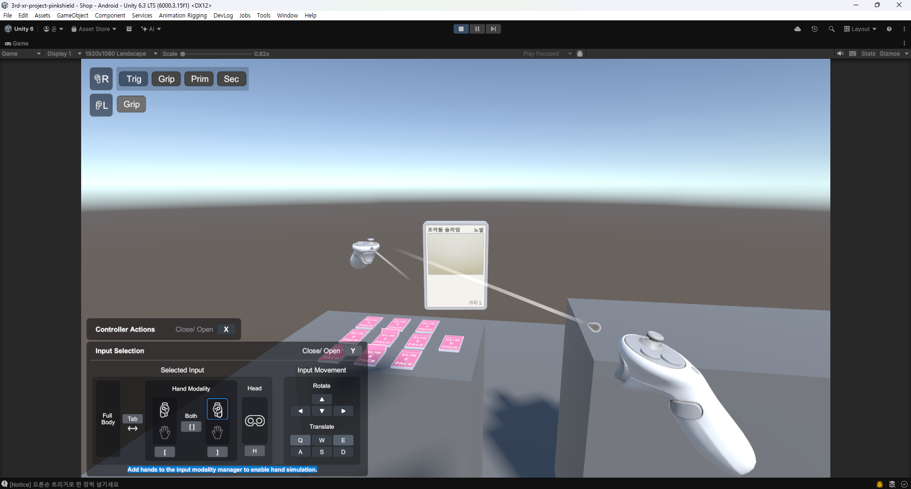

# BUG-002 · 오른손 트리거를 눌러도 팩이 잘리지 않음

| 항목 | 값 |
|---|---|
| 상태 | 해결 <!-- 시뮬레이터 확인, 실기기 확인 전 --> |
| 심각도 | 높음 |
| 발견 | 2026-11-16 |
| 해결 | 2026-11-16 |
| 씬 / 환경 | Shop · 에디터 Play + XR Interaction Simulator (키보드·마우스 가상 컨트롤러) |
| 발견 커밋 | `806c6eb` + 미커밋 TearGestureOpen (main) |
| 해결 커밋 | `305bf3d` (main) |
| 포트폴리오 | <!-- ⭐ 후보면 ⭐ --> |

## 1. 증상 (문제)
- **기대**: 왼손 그립으로 팩을 잡아 눈앞에 띄운 뒤, 오른손 트리거를 누른 채 가이드 선을 따라 그으면 노란 선이 채워지고 70%에서 개봉.
- **실제**: 오른손 트리거를 눌러도 잘리지 않음.

> 📷 before 없음 — 수정 전에 촬영하지 못했습니다.

## 2. 재현 단계
1. XR Interaction Simulator로 Shop 씬 Play (처음엔 Link로 짐작했으나 사용자 확인 결과 시뮬레이터)
2. 선반의 팩을 왼손 그립으로 잡음
3. 오른손 트리거를 누른 채 팩 윗부분을 가로로 그음 → 반응 없음

재현율: 항상 (사용자 보고)

## 3. 콘솔 로그
```text
에러·예외 없음 (Editor.log 확인)
```

## 4. 원인 (추정 — Link 재확인 전)
`TearGestureOpen.cs`의 자르기 판정이 오른손 인터랙터의 **`transform.position`(컨트롤러 원점, 손잡이 중앙 근처)** 만 보고 있었습니다. 이 점이 팩 로컬 기준으로 자르는 선 위아래 4cm, 앞뒤 8cm 안에 들어와야 인정됐습니다.
그런데 실제로는 컨트롤러 몸체가 먼저 팩에 닿기 때문에, 손잡이 중앙을 그 범위에 넣기가 거의 불가능합니다. 에러 없이 "트리거를 눌러도 아무 일 없음"으로 보인 것과 맞습니다.

**원인 후보 2 — 시뮬레이터 입력 구조 (XRI 3.5.1 소스로 확인)**
시뮬레이터는 버튼(G 그립, T 트리거)을 **Shift를 누르고 있으면 왼손, 떼면 오른손**에 보냅니다(`XRInteractionSimulator.ProcessControlInput`).
- Shift+G로 왼손 그립 → Shift+T를 누르면 트리거도 **왼손**으로 감
- G를 누른 채 Shift를 떼면 그립이 **오른손**으로 넘어가 오른손이 팩을 뺏어 잡을 수 있음(→ 눈앞 고정 해제)
- 즉 "왼손 그립 유지 + 오른손 트리거"를 키를 누르고 있는 방식으로는 만들기 어렵습니다. 대신 **빠른 동작(Quick Action) 토글**(`` ` ``로 그립 선택, Space로 켜고 끄기)은 버튼을 켜 둔 채로 유지되고, 손 전환(`[`, `]`)해도 지워지지 않습니다.

## 5. 해결
자르는 지점을 두 가지로 찾도록 바꿨습니다 (`TearGestureOpen.TryGetCutPoint`).
1. **손끝**: Near-Far 인터랙터의 근접 판정 지점(`nearInteractionCaster.effectiveCastOrigin`)이 팩 앞뒤 6~8cm 안에 있으면 그 위치를 씀
2. **레이저**: 아니면 조준 방향(`farInteractionCaster.effectiveCastOrigin`)의 레이가 팩 면에 닿는 점을 씀 (손에서 0.8m 이내)

→ 손을 가까이 대고 그어도, 보이는 레이저로 선을 따라 그어도 잘림.
덧붙여 오른손 인터랙터를 찾지 못하면 경고 로그를 남기도록 했습니다.

## 6. 결과
- Unity의 Roslyn으로 CardShop.Runtime 단독 컴파일 성공 (에디터 재컴파일·EditMode 테스트는 Unity 창 활성화 후)
- 시뮬레이터(빠른 동작으로 왼손 그립 유지 + 오른손 레이저)로 잘라서 개봉되는 것 확인 (2026-11-16 22:20 캡처)
- Quest 실기기 확인은 아직



*수정 후 (22:20, BUG-003 after와 같은 캡처): 시뮬레이터에서 왼손 그립 유지 + 오른손 트리거로 잘라 팩이 열린 결과. 노란 자른 선이 채워지는 중간 장면은 아직 없음*

## 7. AI 협업
- 내가 한 일: Link 테스트에서 증상 발견·보고
- AI가 제안한 것: 판정 기준점 문제로 원인 추정, 손끝 + 레이저 두 방식으로 판정 확장
- 받아들임 / 고침 / 거절 — 이유: (사용자 작성)
- 관련 대화: (worklog 세션 링크)

## 8. 배운 점
- VR에서 "손 위치"는 하나가 아니다. 컨트롤러 원점, 손끝(근접 판정), 조준(레이) 지점이 서로 다르니, 판정에 어느 점을 쓰는지 정해야 한다.
- 판정 범위는 손 크기·컨트롤러 크기를 고려해 넉넉하게 잡고, 실기기에서 줄여 간다.
