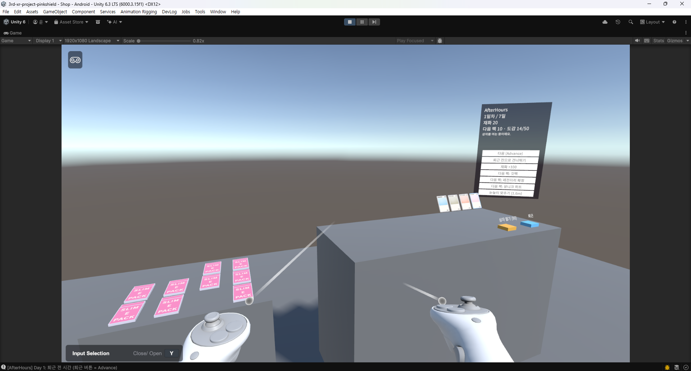
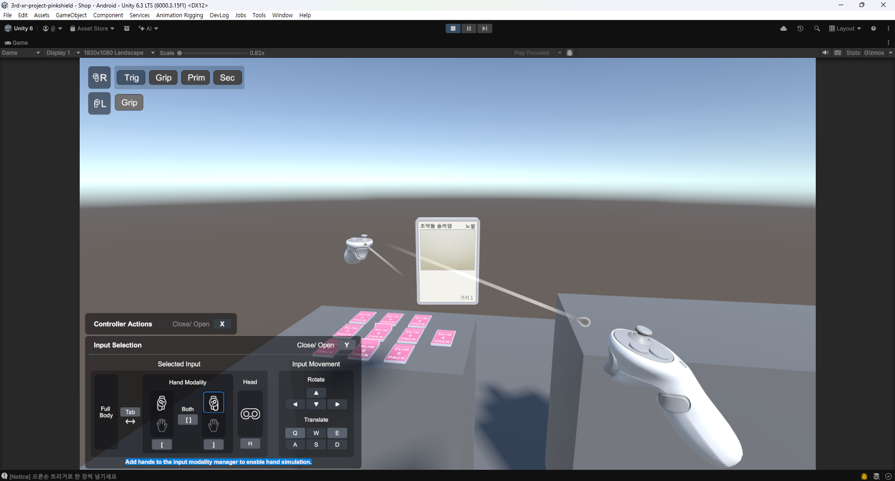

# BUG-003 · 개봉한 카드 묶음이 눈앞에 안 보임 (Rigidbody 보간이 위치를 되돌림)

| 항목 | 값 |
|---|---|
| 상태 | 해결 <!-- 에디터 1회 확인, 연속 개봉 확인 전 --> |
| 심각도 | 높음 |
| 발견 | 2026-11-16 |
| 해결 | 2026-11-16 |
| 씬 / 환경 | Shop · 에디터 Play + XR Interaction Simulator |
| 발견 커밋 | `806c6eb` + 미커밋 카드 넘기기 (main) |
| 해결 커밋 | `305bf3d` (main) |
| 포트폴리오 | <!-- ⭐ 후보면 ⭐ --> |

## 1. 증상 (문제)
- **기대**: 팩을 자르면 팩이 있던 자리(눈앞 35cm)에 카드 5장이 묶음으로 나타난다.
- **실제**: 팩은 열렸는데(재화 차감) 눈앞에 카드가 안 보임. **될 때도 있고 안 될 때도 있음.**



*수정 전 (22:06): 넘기기 연출은 진행 중인데(디버그 패널 "상자를 여는 중이에요" = 넘기기 중이라 개봉 잠금) 카드가 눈앞이 아니라 카운터 뒤쪽 옛 자리에 놓여 있음*

## 2. 재현 단계
1. 퇴근 후 페이즈에서 팩을 한 번 열어 카드가 카운터에 놓이게 함 (카드가 풀에 들어감)
2. 다른 팩을 왼손으로 잡아 눈앞에 띄우고 오른손으로 자름
3. 카드 묶음이 눈앞에 안 보이고 카운터 쪽에 있음

재현율: 가끔 (진단 로그 기준 3회 중 1회)

## 3. 콘솔 로그
진단 로그(`[DIAG]`, 원인 확인 후 제거)로 카드 위치(`pos`)와 Rigidbody 위치(`rb`)를 프레임별로 찍음.
```text
2번째 개봉
[DIAG] f0  Card pos=(-1.279, 1.318, -0.038)  rb pos=(0.150, 1.100, 0.500)   ← Transform은 눈앞, 물리는 옛 자리
[DIAG] f1  Card pos=( 0.150, 1.100,  0.500)  rb pos=(0.150, 1.100, 0.500)   ← 다음 프레임에 옛 자리(카운터)로 되돌아감
1·3번째 개봉
[DIAG] f1  Card pos=(-1.317, 1.318, -0.046)  rb pos=(-1.317, 1.318, -0.046) ← 정상
```
에러는 없음. XRI 경고 "Cannot throw a kinematic Rigidbody…"가 여러 번 있었음(아래 5절에서 함께 정리).

## 4. 원인
카드 프리팹의 Rigidbody가 **Interpolate(보간)** 로 설정되어 있었습니다(`CardPrefabBuilder`가 `rb.interpolation = Interpolate`).
보간을 쓰면 물리 엔진이 매 프레임 "직전 물리 위치 ↔ 현재 물리 위치" 사이 값을 Transform에 써 넣습니다. `CardRevealView.Show`/`Fly`는 **Transform만** 옮겼기 때문에,
- 옮긴 뒤 **물리 스텝이 먼저 오면** → Transform이 물리로 동기화되어 정상 (1·3번째)
- **렌더 프레임이 먼저 오면** → 보간이 옛 물리 위치(이전 개봉 때 카운터 자리)로 Transform을 덮어씀 → 카드가 카운터로 튀어 돌아감 (2번째)

프레임과 물리 스텝(0.02초)의 순서에 따라 결과가 달라져서 간헐적으로 나타났습니다. 처음 놓이는 카드는 옛 위치가 원점 근처라 티가 덜 났고, **풀에서 재사용된 카드**에서 드러났습니다.

처음에는 "XRI도 잡은 팩을 Transform으로 옮기는데 잘 되니 보간은 원인이 아니다"라고 판단해 이 가설을 버렸습니다. XRI는 **매 프레임** Transform을 다시 쓰기 때문에 되돌아가도 바로 덮어써서 문제가 안 보였던 것이고, 우리 코드는 **한 번만** 옮기기 때문에 드러났습니다. 추측 대신 진단 로그로 값을 찍어 확정했습니다.

## 5. 해결
- `CardRevealView`
  - 공개용 카드는 스크립트로만 움직이므로 Awake에서 `interpolation = None`
  - 이동은 `Teleport()`로 **Transform과 Rigidbody(position/rotation)를 함께** 설정 (Show, 날아가기 모두)
  - `throwOnDetach = false`: 키네마틱 카드를 놓을 때 나던 XRI 경고 제거
- `TearGestureOpen`(팩 눈앞 고정)도 같은 위험이 있어 같은 방식으로 수정: 고정하는 동안 보간 끄고 Rigidbody 위치도 함께 설정, 고정이 풀리면 원래 보간으로 복원
- 진단 로그 제거. 대신 `GameEvents.RaiseNotice`가 에디터·개발 빌드에서 `[Notice]`로 콘솔에도 찍히게 함(흐름 추적용)

고려한 다른 방법: 옮길 때마다 `Physics.SyncTransforms()` 호출 → 씬 전체 동기화라 비용이 크고, 근본 원인(보간)이 남음.

## 6. 결과
- Unity Roslyn으로 CardShop.Runtime 컴파일 성공



*수정 후 (22:20): 팩을 자른 자리(눈앞)에 카드 묶음이 나오고 맨 앞 카드(조약돌 슬라임 · 노말)가 보임. 하단 콘솔에 `[Notice] 오른손 트리거로 한 장씩 넘기세요`*

- 수정 후 에디터(XR Interaction Simulator)에서 1회 확인. 여러 번 연속 개봉 확인은 아직.

## 7. AI 협업
- 내가 한 일: 증상 발견·보고, 진단 로그를 넣은 빌드로 재현
- AI가 제안한 것: 처음엔 정적 분석으로 보간 가설을 세웠다가 스스로 기각 → 진단 로그 제안 → 로그로 보간 원인 확정 → 수정
- 받아들임 / 고침 / 거절 — 이유: (사용자 작성)
- 관련 대화: (worklog 세션 링크)

## 8. 배운 점
- Rigidbody가 있는 물체를 **스크립트로 순간이동**시킬 때는 Transform만 옮기면 안 된다. 보간이 켜져 있으면 물리가 옛 위치로 되돌릴 수 있다. Rigidbody 위치도 같이 옮기거나 보간을 끈다.
- 간헐적 버그는 추측보다 **프레임별 값 로그**가 빠르다. "Transform 위치 vs Rigidbody 위치"를 나란히 찍자 한 번에 보였다.
- 비슷해 보이는 사례(XRI는 되는데?)로 가설을 기각할 때는, 두 경우의 차이(매 프레임 vs 한 번)를 먼저 확인한다.
