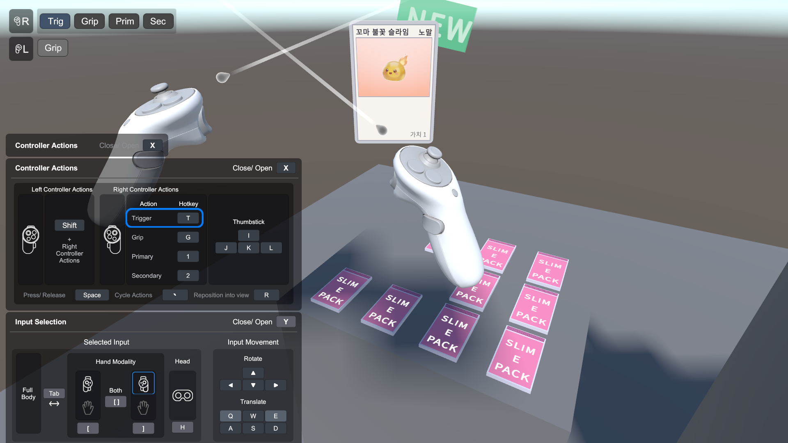

# BUG-004 · New 뱃지 위치 불량

| 항목 | 값 |
|---|---|
| 상태 | 열림 |
| 심각도 | 보통 |
| 발견 | 2026-11-17 17:55 |
| 해결 | - |
| 씬 / 환경 | Shop · 에디터 · XR Device Simulator · 플레이 265.2s |
| 발견 커밋 | `f03ca35` (main, 미커밋 변경 있음) |
| 해결 커밋 | - |
| 포트폴리오 |  |

## 1. 증상 (문제)
- **기대**: new 가 카드 앞에서 배치
- **실제**: new 가 카드 뒤에서 배치되어 있음
new 가 아직 너무 큼, 현재 사이즈의 20% 로 해도 괜찮을 듯 함



## 2. 재현 단계
1.  
2. 
3.

재현율: (미확인)

## 3. 콘솔 로그
```text
[17:50:53] Warning: XR: Error setting active audio output driver. Falling back to default.
    at UnityEngine.XR.Management.XRGeneralSettings:AttemptInitializeXRSDKOnLoad ()
[17:50:58] Warning: Failed to get haptic capabilities of XRSimulatedController:/XRSimulatedController1, error code -1. Continuing assuming a single haptic channel.
    at UnityEngine.XR.Interaction.Toolkit.Interactors.XRBaseInputInteractor:SendHapticImpulse (single,single)
[17:51:14] Warning: Failed to get haptic capabilities of XRSimulatedController:/XRSimulatedController, error code -1. Continuing assuming a single haptic channel.
    at UnityEngine.XR.Interaction.Toolkit.XRInteractionManager:Update () (at ./Library/PackageCache/com.unity.xr.interaction.toolkit@63ca3b7ce776/Runtime/Interaction/XRInteractionManager.cs:672)
```

## 4. 원인
- **크기**: TMP 3D 글자는 `fontSize` 1당 약 10cm. 배지 글자 0.2(A2에서 줄인 값)는 글자 높이 약 2cm로, 카드 폭(6.3cm)의 거의 전부였음. 처음 0.35는 더 컸음.
- **"뒤에 배치"**: 카드 글자(`노말` 등)와 배지가 둘 다 투명 렌더링이라 **카메라와의 거리 순으로 그려지는데**, 배지가 카드 모서리에 있어 보는 각도에 따라 카드 글자보다 먼저 그려져 글자 *뒤*처럼 보임. z 오프셋 0.8mm로는 정렬이 보장되지 않음.

## 5. 해결
- 글자 크기 0.2 → **0.045**(사용자 요청: 현재의 20%), 위치는 모서리 안쪽 6mm, 배지 영역 축소 (`CardRevealView`).
- 배지 렌더러에 `sortingOrder = 20`을 주어 투명 정렬에서 항상 카드 글자보다 나중에 그림.
- 상태: 코드 수정 완료, Unity 확인 전.

## 6. 결과
(미작성 — 고친 뒤 after 스크린샷: Shift+F9 후 /devlog bug BUG-004)

## 7. AI 협업
- 내가 한 일:
- AI가 제안한 것:
- 받아들임 / 고침 / 거절 — 이유:
- 관련 대화:

## 8. 배운 점
