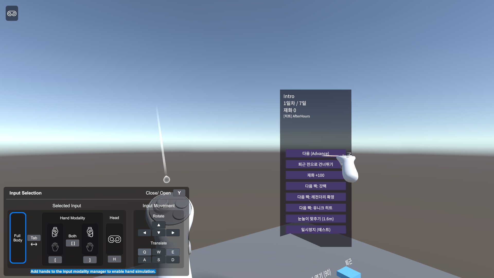

# BUG-005 · 메뉴 UI 피드백 불량

| 항목 | 값 |
|---|---|
| 상태 | 열림 |
| 심각도 | 보통 |
| 발견 | 2026-11-17 18:06 |
| 해결 | - |
| 씬 / 환경 | Shop · 에디터 · XR Device Simulator · 플레이 160.9s |
| 발견 커밋 | `f03ca35` (main, 미커밋 변경 있음) |
| 해결 커밋 | - |
| 포트폴리오 | ⭐ |

## 1. 증상 (문제)
- **기대**: 다음 UI 에 raycast를 쏘면 노란색으로 변한다
- **실제**: 첫번째 다음 버튼 이후 가끔씩 노란색으로 변하지 않는 현상



## 2. 재현 단계
1. 컨트롤러로 다음(advance) 쪽으로 raycast 를 쏜다
2.  쏘면 노란색으로 변한다 (현재는 첫번째 다음 이후 변하지 않음) 
3.

재현율: (미확인)

## 3. 콘솔 로그
```text
[18:03:20] Warning: XR: Error setting active audio output driver. Falling back to default.
    at UnityEngine.XR.Management.XRGeneralSettings:AttemptInitializeXRSDKOnLoad ()
[18:03:25] Warning: Failed to get haptic capabilities of XRSimulatedController:/XRSimulatedController, error code -1. Continuing assuming a single haptic channel.
    at UnityEngine.XR.Interaction.Toolkit.Interactors.XRBaseInputInteractor:SendHapticImpulse (single,single)
[18:03:33] Warning: Failed to get haptic capabilities of XRSimulatedController:/XRSimulatedController1, error code -1. Continuing assuming a single haptic channel.
    at UnityEngine.XR.Interaction.Toolkit.Interactors.XRBaseInputInteractor:SendHapticImpulse (single,single)
```

## 4. 원인
- Unity UI `Selectable`은 상태 우선순위가 **눌림 > 선택(Selected) > 하이라이트 > 보통**임. 버튼을 한 번 누르면 EventSystem의 *선택* 대상으로 남고, 그 뒤에는 레이를 다시 대도 `Selected` 상태(색 = 보통색)가 하이라이트보다 우선이라 노란색으로 안 바뀜.
- 그래서 "첫 번째 **다음** 버튼을 누른 뒤부터" 그 버튼만 가끔 안 바뀐 것(다른 버튼을 누르면 선택이 옮겨 가며 다시 정상).

## 5. 해결
- `UiHoverFeedback`에 `IPointerUpHandler`를 추가: 누른 직후 그 버튼이 선택 상태이면 선택을 해제(`SetSelectedGameObject(null)`).
- 상태: 코드 수정 완료, Unity 확인 전.

## 6. 결과
(미작성 — 고친 뒤 after 스크린샷: Shift+F9 후 /devlog bug BUG-005)

## 7. AI 협업
- 내가 한 일:
- AI가 제안한 것:
- 받아들임 / 고침 / 거절 — 이유:
- 관련 대화:

## 8. 배운 점
