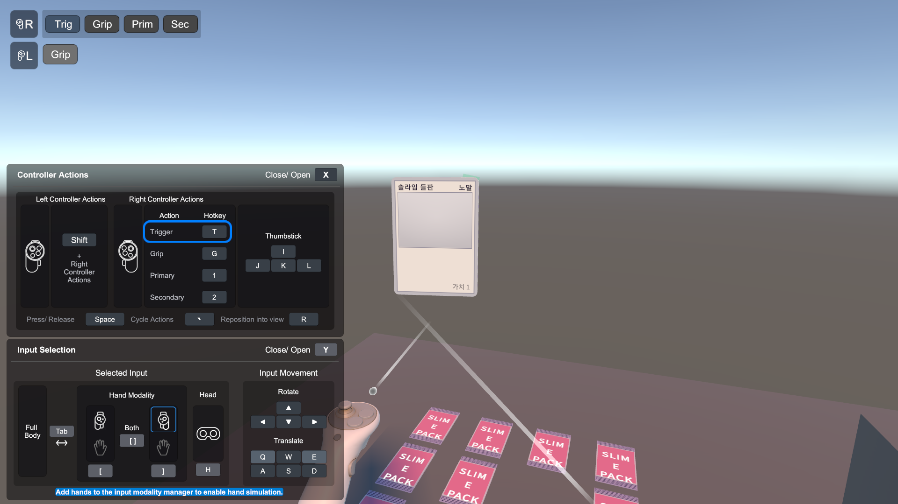

# BUG-006 · new 배지 표시 불량

| 항목 | 값 |
|---|---|
| 상태 | 열림 |
| 심각도 | 보통 |
| 발견 | 2026-11-17 18:54 |
| 해결 | - |
| 씬 / 환경 | Shop · 에디터 · XR Device Simulator · 플레이 86.0s |
| 발견 커밋 | `f03ca35` (main, 미커밋 변경 있음) |
| 해결 커밋 | - |
| 포트폴리오 |  |

## 1. 증상 (문제)
- **기대**: new 배지가 카드 앞면 위오 표시가 됨
- **실제**: new 배지가 카드 앞면 위오 표시가 안됨



## 2. 재현 단계
1. 
2. 
3.

재현율: (미확인)

## 3. 콘솔 로그
```text
[18:52:44] Warning: Failed to get haptic capabilities of XRSimulatedController:/XRSimulatedController, error code -1. Continuing assuming a single haptic channel.
    at UnityEngine.XR.Interaction.Toolkit.Interactors.XRBaseInputInteractor:SendHapticImpulse (single,single)
[18:52:47] Warning: Failed to get haptic capabilities of XRSimulatedController:/XRSimulatedController1, error code -1. Continuing assuming a single haptic channel.
    at UnityEngine.XR.Interaction.Toolkit.Interactors.XRBaseInputInteractor:SendHapticImpulse (single,single)
```

## 4. 원인
- BUG-004에서 정렬만 고치려고 `sortingOrder`를 주었지만, 배지는 **카드 앞면 위에 따로 띄운 투명 3D 글자**라 카드 면과의 깊이 · 렌더 순서에 의존함. 보는 각도와 카드 묶음 위치에 따라 일부 카드에서 배지가 카드 면에 가려져 모서리 바깥 조각만 보였음(스크린샷: 카드 위쪽 가장자리에 초록 선만 보임).
- 카드 글자(이름 · 등급)는 같은 방식인데도 잘 보이는 점으로 보아, 글자와 **같은 z · 같은 층**에 두는 것이 안전.

## 5. 해결
- 배지를 카드 모서리에 걸치는 방식을 버리고, **카드 글자와 똑같은 z(앞면 바로 앞 0.3mm)** 에 **그림 영역 오른쪽 위 안쪽**(이름 · 등급 글자와 겹치지 않는 자리)으로 옮김. `sortingOrder` 지정은 제거 (`CardRevealView.CreateNewBadge`).
- 상태: 코드 수정 완료, Unity 확인 전.

## 6. 결과
(미작성 — 고친 뒤 after 스크린샷: Shift+F9 후 /devlog bug BUG-006)

## 7. AI 협업
- 내가 한 일:
- AI가 제안한 것:
- 받아들임 / 고침 / 거절 — 이유:
- 관련 대화:

## 8. 배운 점
