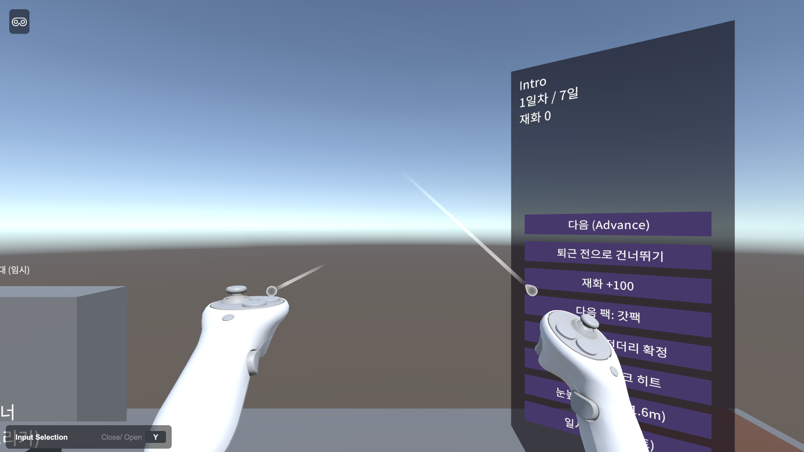

# BUG-007 · 타이틀에서 시작(Advance)을 누르면 시점이 튐 (눈높이 재보정)

| 항목 | 값 |
|---|---|
| 상태 | 해결 (재확인 전) |
| 심각도 | 보통 |
| 발견 | 2026-11-17 |
| 해결 | 2026-11-18 |
| 씬 / 환경 | Shop · 에디터(XR Device Simulator)에서 재현 |
| 발견 커밋 | `d26d4ec` (main, 미커밋 변경 있음) |
| 해결 커밋 | - |
| 포트폴리오 | |

## 1. 증상 (문제)
- **기대**: 디버그 패널의 "다음 (Advance)"를 트리거로 눌러도 플레이어 시점은 그대로.
- **실제**: 가끔 시점이 키 1.6m 재보정을 한 것처럼 갑자기 위치가 바뀜.



(타이틀 → Intro로 넘어간 직후 화면)

## 2. 재현 단계
1. 플레이 시작, 타이틀 페이즈에서
2. 디버그 패널 "다음 (Advance)"를 레이 + 트리거로 누름
3. Intro로 넘어가는 순간 시점 높이가 바뀜

재현율: 타이틀에서 누를 때 (사용자 확인). 다른 페이즈의 Advance에서는 생기지 않음.

## 3. 콘솔 로그
```text
(오류 로그 없음 — 의도된 코드가 실행된 결과)
```

## 4. 원인
- 타이틀의 Advance는 `TitlePhase.OnAdvanceRequested` → `GameContext.StartNewSession()`을 부름 (`Runtime/Core/Phases/GamePhases.cs`).
- `PlayerHeightCalibrator`가 `SessionStarted`를 구독해 새 게임마다 `Calibrate()`를 실행했음 (수정 전 `Runtime/Interaction/PlayerHeightCalibrator.cs:42`).
- `Calibrate()`는 **지금 머리 높이**를 기준으로 XR Origin 높이를 옮겨 눈을 1.6m에 맞춤. 버튼을 누르려고 몸을 기울이거나 고개를 숙인 상태면 그 자세가 기준이 되어 시점이 튐.
- "가끔"으로 느껴진 이유: 이 경로는 타이틀(그리고 일시정지 메뉴의 "처음부터")에서만 실행되기 때문.

## 5. 해결
- 자동 보정은 **앱 시작 때 한 번만** 하고, 새 게임 시작 때는 하지 않도록 `SessionStarted` 구독을 지움. 플레이어 키는 판이 바뀌어도 그대로이므로 다시 맞출 이유가 없음.
- 디버그 패널의 "눈높이 맞추기 (1.6m)" 수동 버튼은 그대로 둠.
- 고려한 다른 방법: 화면 전환(페이드) 중에만 보정 → 자세 문제는 그대로라 채택 안 함.

## 6. 결과
- 수정 후 재확인 전. (after 사진 필요)


## 7. AI 협업
- 내가 한 일: 증상 보고, 발생 상황이 "타이틀"이었다고 확인, 수정 전 사진 촬영.
- AI가 제안한 것: 코드를 읽어 `StartNewSession` → `SessionStarted` → `Calibrate` 경로를 원인 후보로 짚고, 자동 보정을 앱 시작 1회로 줄이는 수정.
- 받아들임 / 고침 / 거절 — 이유: 받아들임 (사용자가 수정 진행 지시).
- 관련 대화: 2026-11-17 손님 구현 세션

## 8. 배운 점
