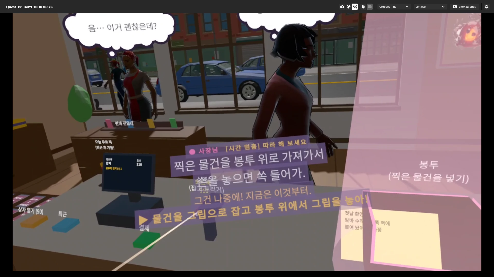
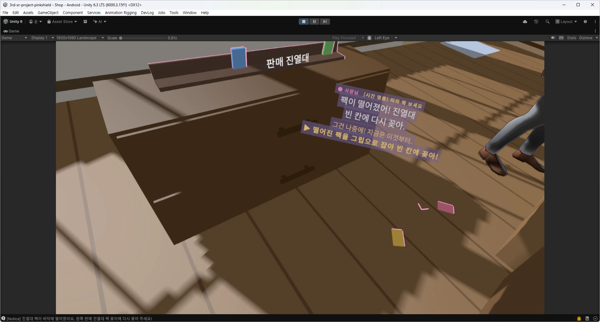

# BUG-020 · 튜토리얼 "다른 물건 잠그기"가 잡아야 할 물건까지 손에서 놓게 함

| 항목 | 값 |
|---|---|
| 상태 | 해결 (Play 확인 전) |
| 심각도 | 높음 (튜토리얼에서 진행이 막힘) |
| 발견 | 2026-11-19 (Quest 3s 빌드 테스트) · 2026-11-20 (에디터 Play, 같은 원인 두 번째) |
| 해결 | 2026-11-19 · 2026-11-20 |
| 씬 / 환경 | Shop · Quest 3s 실기기 / 에디터 |
| 발견 커밋 | `e40c3c3` (claude/game-feedback-analysis-design-ca031e) |
| 해결 커밋 | `d054d81` (계산대 물건), `14d440e` (잠그기 일반 수정 · 흐트러진 팩) |
| 포트폴리오 | ⭐ 후보 (원인이 의외 — 엔진(XRI) 동작이 "부모 관계" 판정을 깨뜨림) |

## 1. 증상 (문제)
- **기대**: 튜토리얼 정지 단계에서, 지금 할 일의 대상 물건은 잡을 수 있고 다른 물건만 잠김(DEC-028).
- **실제**:
  - 1일차 첫 계산: 바코드를 찍은 카드팩을 잡으면 바로 손에서 떨어지고 "그건 나중에! 지금은 이것부터."가 뜸 → 봉투에 담지 못함 (사용자: "일시 정지로 카드팩을 못 건드리게 하는 것 같다").
  - 2일차 흐트러진 팩: 바닥 팩이 잘 안 잡힘. "막 누르다 보니 어쩌다 통과" (체크 목록 9장 "가장 답답했던 순간").




## 2. 재현 단계
1. 새 게임 → 1일차 첫 손님 → 스캐너를 잡고 카드팩 바코드를 찍음
2. 봉투 단계에서 카드팩을 그립으로 잡음 → 바로 놓아짐
3. (2일차) 흐트러진 팩 정지 단계에서 바닥 팩을 잡음 → 바로 놓아짐

재현율: 항상 (잠그기 전에 이미 손에 들고 있던 경우만 예외 — "어쩌다 통과"의 이유로 추정)

## 3. 콘솔 로그
```text
(오류 없음 — 의도한 잠그기 동작이 잘못된 대상에 걸린 것)
```

## 4. 원인
- 잠그기(`InteractionLock`)는 "지금 단계의 대상과 그 짝(스캐너 · 계산대 물건)이 아닌 물건"을 손에서 놓게 함. 짝인지는 **Transform 부모 관계**로 판정했음:
  - 계산대 물건 = `CheckoutCounter`의 자식인가 (`TutorialGrabWatcher.IsHelper`)
  - 대상 = 단계 대상 오브젝트의 자식 · 부모인가 (`TutorialGrabWatcher.Related`)
- 그런데 **XRI `XRGrabInteractable`은 잡는 순간 물건의 부모를 떼어 냄**(`SetParent(null)`, 패키지 코드 `XRGrabInteractable.cs` 2520줄 근처, 놓으면 되돌림). 잡힌 순간 계산대 물건도 · 꽂이(`PackRack`)의 팩도 "아무 관계 없는 물건"이 되어 바로 놓아짐.
- 흐트러진 팩 단계는 대상이 기록만 하는 빈 오브젝트(`MessyPackSpot`, 모양 없음)와 꽂이라서, 실제로 잡는 팩(`RackPack`, 꽂이의 자식)은 위 판정에 기대고 있었음.
- 사용자가 추측한 "일시정지(시간 멈춤)"는 원인이 아님: `IsHeld`는 게임 시간만 멈추고 잡기는 막지 않음.

## 5. 해결
- 11-19: `IsHelper`가 `ScannableItem` 컴포넌트로도 계산대 물건을 알아보게 함 (부모가 바뀌어도 컴포넌트는 그대로).
- 11-20 (같은 종류를 한 번에): `InteractionLock.Lock`이 **잠글 때 대상 밑에 있던 잡을 수 있는 물건(`XRBaseInteractable`)을 미리 모아 두고** 그것은 놓게 하지 않음 → 부모 관계에 기대지 않음.
- 강조도 물건 자체에: 계산대 물건마다 `item-to-scan` / `item-to-bag` 이름표, 흐트러진 팩은 떨어진 팩 하나하나에 이름표 (DEC-033).

## 6. 결과
- EditMode 테스트 309 → 323개 모두 통과 (잠그기 자체의 자동 테스트는 없음 — XRI 인터랙터가 필요).
- Quest · 에디터 Play 확인 전: [아침 보고 11-20](../아침보고_11-20.md) 확인 목록 I1.

## 7. AI 협업
- 내가 한 일: 빌드 테스트에서 증상을 찾고 캡처, "일시정지 때문인 것 같다"는 가설과 함께 맡김. 두 번째 증상(흐트러진 팩)을 체크 목록에 남김.
- AI가 제안한 것: 원인을 일시정지가 아니라 XRI의 부모 떼기로 찾음(패키지 코드 확인). 첫 수정은 계산대 물건만 고쳤고, 두 번째 증상은 다음 날 캡처 4의 자막을 보고 같은 원인임을 알아챔 → 잠그기 쪽을 일반적으로 고침.
- 받아들임 / 고침 / 거절 — 이유: 받아들임. 다만 첫 수정이 같은 종류의 다른 단계를 놓쳤다는 점은 AI의 한계로 기록 (원인을 찾았을 때 "같은 판정을 쓰는 다른 곳"까지 찾았어야 함).
- 관련 대화: worklog `2026-11-19 · 2026-11-20 빌드 테스트 피드백` 세션

## 8. 배운 점
- 엔진 컴포넌트가 계층 구조를 바꾸는 순간(잡기 · 소켓 · 풀링)에는 "누구의 자식인가"로 정체를 판정하면 깨진다 → 컴포넌트나 미리 모은 목록으로 판정.
- 버그 원인을 찾으면 같은 판정을 쓰는 곳을 모두 찾아 한 번에 고칠 것.
